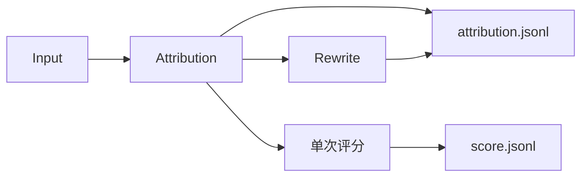

# 单样本归因与评分

AIME 使用 workflow: answer-review。每条回答先完成 Attribution，通过后立即启动一次 Score；不同回答持续共享总并发。评分将已接受归因作为事实依据，不能复核、改写或退回归因。Workbench 与增量 CLI 共用执行器和状态锁，常规 Rewrite 关闭。

全部归因结束后可使用[独立聚类命令](usage.md#独立核验与聚类)冻结本次归因来源，沿用各阶段自己的状态和正式结果契约。聚类完成后输出 `cluster_tree.jsonl` 和独立的 `state.json`；树保留已归类、待观察问题以及无问题回答的覆盖范围，不修改评分或归因结果。

独立评测自行规划任务，配置只包含输入、执行预算、输出、归因润色开关与阶段选择，不要求对战组、聚类或问题库设置。来源编目和按坐标重读使用 `@eval/workflows/inputs`，归因与指令检查共用材料使用 `@eval/workflows/review`；共用模块不依赖对战规划或运行状态。



Score 和 Attribution 不依赖 Criteria，均排除候选 SYS/DEV。原比较流程继续使用自己的 Criteria、归因和 Comparison。

## Score

评分输入为原题、完整最终回答，以及程序整理的必要交付完成情况、问题、实际影响、缺陷确定性、责任机制确定性和必要引文目录。公共事实只保留一次，不复制长轨迹或八步调查；归因中已确认、待核和已恢复状态原样使用。

一次会话提交12核心项、24诊断和独立总分；无搜索、复算或调查工具，不再创建分轴、补查、总分复评会话。模型按固定目录顺序给出选档及问题映射，程序处理身份、名称、证据坐标与引用、复制字段和正式导出。问题不得增删、改写或改变确定性。总分按最终交付独立选档，不平均分项、不按问题数量扣分；已确认且仍存在的最终交付缺陷不得满分，已恢复的过程问题不自动压低总分。

保留结构、枚举、引用存在性、目录映射及评分状态一致性校验。当前提交错误使用既有有限修复预算；失败明确记录，不回退归因，也不暂停其他回答。短时传输故障沿用有界重试，已用额度与接受收据保持不变。

正式结果保持 case_id、final_answer_score、evaluations、diagnostics、findings、evidence、explicit_probability、probability_evidence_ids。总分0–10、12核心项0–4、24诊断不另计分；待核保留有宽度区间。不适用不补0。结构通过不等于语义正确，验收仍抽审源归因及评分映射。

## Attribution 与 Rewrite

问财日常对战和 AIME 单回答评测共用归因实现；原文证据、链路边界、规则作用域、责任定位与动态补读遵循相同校验。

公开题设尚未独立核实时，合理且明确保留未知的条件分析按原问验收；额外的定量换算或公告确认不能仅因材料可用就成为新义务。冲突的身份猜测、频率限定与集合范围保持原强度；区间复算不自行绑定情景。问题引文使用与缺陷相关的完整段落；每个调查步骤独立引用所比较的真实边界，不继承相邻步骤的证据编号。
候选主张保留完整句尾限定，局部原因不自动变成唯一原因；未打印容限内近似值不独立构成数值缺陷。原目标依赖的标的身份仍未确认时，核心完成保留未知，不把另一候选的条件分析算成该目标已完成。点评集中说明判断差异，原文由证据编号回填。

链路读取校验同时认可已实际交付的完整 JSON 字符串叶子；可拼接同一物理来源的相邻读取，但不借用其他路径、消息或初始预览，也不把不完整序列化片段视为完整文本。原始引文和责任仍按各自坐标校验。

必要读取声明涵盖已采集调用的关键边界，不依赖最终回答是否引用该调用。判稿前按真实坐标补齐仍未读的来源，短字段可在一次反馈中批量提供；每页保留原文与证据坐标，内容修复额度不因补读消耗。长页仍按输出预算分段，全部必读范围完成后才校验判词。

Attribution 与 comparison 使用同一default入口，Workflow适配来源及业务身份。结果包含summary、findings、criterion_assessments、core_assessment、正确性与数值核验；问题描述位于finding.problem，优点的problem为null。每个问题的component是责任对象数组，恰有一个primary主责，可有contributing关联责任。各责任独立记录技术域、二级功能、实际组件、环节、中文机制、确证或推断、理由及证据；推断必须给出关键缺口和替代解释。缺陷的established/uncertain与责任的confirmed/inferred分别判断，已确认问题不因因果材料不足降级，也不能以空责任结束。目录唯一来源为[技术目录](../packages/prompts/resources/attribution/taxonomy.json)。

模型直接调用 `submit_evaluation` 提交每条问题的案卷：`checks` 为前后边界核查，`causes` 为责任选择，`calculations` 为源数字绑定的复算。责任只选择 `transition_index` 和功能分类 `function_index`，主体、链路、步骤及证据由实际转换机械绑定。模型仍负责缺陷、实质因果作用、机制、缺口和替代解释；程序不能代写判词。第一个原因是主责，其后须有独立传播或放大作用。已知主体不能改成未知，未采集的整理者也不能改成接收输入的节点。

转换目录在单次材料组装内复用原文解析及路径定位，保留原始坐标与范围校验；不持久化解析缓存，也不跨 run 复用结果。

`answer.execution_nodes` 按真实模型调用和工具调用登记唯一执行节点，历史输入中的消息重放不新增执行。`answer.transitions` 保存请求形成、执行、传递、生成和交付的证据边界；这些边界不是执行步骤。请求生成者优先采用实际 tool_calls 参数与调用身份关联；请求与返回按明确调用 ID、唯一 query 或既有明确时间关联。实际输入只通过已捕获来源引用、调用身份或唯一完整内容传递关联，不把每个返回接到所有后续模型。未知转换保留前后边界和空主体。同一已采集输出到同一目标调用的同一实际输入位置只登记一个传递边界，合并各业务链的证据、前驱与 chain_indices；涉及多条链时 chain_index 为 null。不同输出记录、不同输入位置和工具返回保持分开。`answer.business_chains` 留在程序端，模型接收 execution_graph 的 nodes、boundaries、links，分别计数执行、传递边界与调用间关联。原文只在来源记录中保存，边界只存坐标，模型边界以证据编号引用集中维护的 transition_evidence 读取导航。

每个 check 独立引用该转换前后证据，说明相关事实保持、改变、恢复或仍未知。所有引用须实际读取。最终生成主责必须核查所引相关上游路径；正确材料进入后首次偏离使用 `input_deviation`，生成端独立新增使用 `independent_addition`，未采集处理者使用 `unknown_transition`。已恢复的上游错误不会阻止下游真实形成定位；正确工具不因结果有错自动有责。结构校验保证证据关联与覆盖，不能替代语义审阅：观察是否忠实、原因是否实质、相关路径是否遗漏，仍需真实样本抽审。

正式 `problem.component` 保留真实主体、业务位置、技术分类、`transition_index`、`basis` 和证据引用；`problem.investigation` 是扁平转换核查，`problem.calculations` 保存原数证据、单位、期间、分母和公式。原文只保存在 finding.evidence。`explicit_process` 必须有直接参数生成、推理或计算动作记录；只有输入输出差异则使用 `boundary_comparison + inferred`，机制正文也保留推断。缺陷本身仍可 established。最终内容位置不构成形成证据。

复算支持算术、比率、基准变化、累计复利和带假设的年化。原数必须完整出现在对应证据中，程序用精确十进制算术验证公式、显示倍率、舍入和上下界，错误结果拒收而不代改。年化仅为 run-rate，不自动等于全年指引；成本和市值分母不得混用。单位、期间及公式业务含义仍须对照材料核实，数值相等不是语义已确证。

提交 Schema 严格限制形状与目录范围，业务反馈提供失败字段与真实边界导航；不静默删除字段或生成判词。仅缺 `investigation_read_required` 时，Worker 保存草稿并真正补读，动态范围在 Host/Worker 同步登记到受保护预算，不消耗探索或内容修复额度。重复范围不增加额度，新增范围按字符及页数登记；实际读取后相同缺口无进展则有界停止。混有内容错误时修复额度照常计数。所有正式结果和失败状态保留真实原因。

代理资产的走势参考与目标资产实际报价分别验收。跨资产或单位的实际报价须有本次转换规则、参数和日期依据，不能用常识比例填补证据缺口；缺少支持时确认具体报价的引用口径缺陷，不因此自动追责代理选择或工具实现。调查修复反馈提供当前 Schema 与转换索引，证据统一使用账本 reference 选号；尚未登记的来源提供读取导航，不让模型手拼原始证据 ID。

主归因只读取公开原题、交付、验收要求、参考及过程事实。SYS/DEV和已确认加载的Skill规范从模型材料及可读来源同时排除；原始来源保留在Workflow用于后置独立会话。证据仍由账本生成编号、校验原文坐标并回填，模型选择编号，不复制引文或手算坐标。

Workflow提供`answer.component_catalog`身份目录，独立于技术域和二级功能分类。实际组件优先沿用轨迹明确给出的节点、Agent、工具或服务名；`llm-call-*`、span ID、UUID等只在调用关联和证据导航中保留。匿名责任显示“未命名＋可确认角色＋消息坐标”，不以业务问题名称冒充真实组件，不推测名称或模型型号。多条匿名或同名模型记录分别定位，不合并成通用“回答模型”。Agent选择目录编号，程序校验目录与原始事实的对应关系；名称通过目录的`message_indices`和`identity_evidence`关联回实际节点。正式责任、导出与聚类样本保留节点、环节、功能、机制、主责或关联角色及确定性。聚类按“实际组件 / 处理环节 / 功能”分桶，技术域只作分类元信息，不能作为最终责任结论。

调用目录用semantic_role区分模型节点和工具记录；唯一明确的parent_span关联提供invoking_model_message_index导航，缺失或歧义时不猜配。已加载Skill在输入快照中的原文副本同样排除，未改写的事实叶保留原始坐标。

常规链路不新增独立指令检查会话。已接受的历史指令检查结果保留其原收据和版本，不用于改写主归因。

summary、text、reason以及problem的label、definition采用简体中文，专有名词及真实引文保留原语言。正式归因JSONL在顶层保存完整归因结果与来源元信息，证据位于对应finding或正确性核验中。源meta原样保留，仅用于导出。

结果验收使用同一语言规则，只读检查，不修改结果、不调用模型：

```bash
npm run attribution:check-language -- --input /path/to/attribution.jsonl --limit 100
```

省略`--limit`检查整个文件；指定时检查文件前N行。报告按字段分别统计passed、failed、not_applicable，失败项带1起始物理行号及trace_id、task_id。存在真实失败时返回退出码2，全部通过时返回0；读取与文件更新冲突时重新读取完整范围，连续冲突则明确报错。strength的null字段不会触发中文失败。此检查只验收上述点评字段，不替代证据和完整结果Schema校验。

Rewrite只接收summary、问题表述、理由、名称和定义等文本槽位，不接触证据、Score或责任数组。结果作为rewritten附加在归因行，原始判断与已接受Score保持不变。

## 运行

```bash
npm run eval -- preflight --config configs/host.json --config configs/answer-review.json --config /absolute/path/source-and-models.json
npm run eval -- run --run-id answer-review-run --config configs/host.json --config configs/answer-review.json --config /absolute/path/source-and-models.json
```

来源配置可包含一个或多个模式。--stage attribution 仅归因；--stage score 同时确保本条归因先就绪。续跑补建缺失任务，保留已接受收据和已用额度。score、attribution、rewrite 使用各自模型绑定，共享整个运行并发上限。

只验收归因时使用 `run --stage attribution`：Score 不是归因完成的前置或后置条件，不创建评分任务，也不生成占位 score.jsonl。后续需要评分时可在同一 run 显式选择 score，复用已接受归因。

`--input ID=PATH`、`--batch`、`--case`和`--limit-cases`沿用公共CLI筛选。`--test-eval`将输出放在同来源的eval_output/test_eval；`--pilot-cases N`同样进入test_eval，按业务题目选择N题及其各模型、所选阶段，完整计划仍保留。普通续跑保留试跑范围，验收后用`--discover-inputs`释放其余已登记回答。`--worker`指定Worker，`--resume-stage`解除指定阶段的熔断，`--skip-failed`保留失败任务，`--balance-channels`沿用渠道分配。日常输出使用本来源的eval_output/0_daily_eval。

`status`、`report`、`validate`通过`--run`读取保存的workflow，不依赖当前模型配置；分别查看状态、生成报告、校验正式结果与收据。

正式结果为results/score.jsonl、results/attribution.jsonl和results/instruction_review.jsonl，另有state.json、stats.json和report.md。正式输出的顶层meta原样保留源记录的外层meta（包括嵌套值、null及空对象；原记录没有meta时不新增）。它不混入trace.meta，也不发送给裁判。续跑只为缺少meta的已接受结果补齐源meta，已保存的判词、分数和来源字段保持不变，Rewrite同样保留meta。未完成任务重新定位源记录并使用当前题面、最终回答位置和行号；材料坐标变化时丢弃失效草稿与取证账本，保留已用尝试和内容额度。

结果同时直接携带实际回答的trace_id、业务日期、输入文件/行号及原归档/成员/行号/数组项坐标；一般手工输入没有归档坐标时为null。AIME增量入口在清洗阶段要求这些来源完整，见[AIME日常评测](aime-incremental.md)。

工作台按回答统计 AIME 的每日运行和覆盖率，Score 仅在正式终局结果接受后计为完成，每条回答仅有一个评分任务。Score 与主归因成功即计为回答完成；独立指令检查使用独立模型绑定并另列状态和结果，失败可单独重试，不重跑或改写已接受主归因。整体运行仍跟踪后置任务的失败与暂停。列表、详情、统计和定向重试采用相同口径。首次启动将已有规范输入纳入，沿原每日 run 补齐缺失阶段，已接受结果不重复调用模型。自动恢复按精确任务范围执行，补Score不会连带重开同回答已排除的归因失败。显式失败重试保留task ID、累计尝试和内容账本；提高预算后才允许已达上限任务继续，不解除最终账本安全闸。暂停停止分配新任务，等待当前任务完成；清洗在当前包完成后停住，不打开下一包，继续沿同一 run 执行。停止中断当前执行并保存进度，服务重启等待手动继续。非并发配置在下一次启动或暂停后继续时生效，并发可独立调整；AIME 默认64，不占用问财的32额度。AIME 当前只落盘并在页面查看，不交付 MongoDB，不自动聚类。

归因按关键缺口调查、直接提交；评分只使用已接受事实并一次选档。不同样本持续补位，共享总并发。

每日运行目录与增量追加规则见[AIME日常评测](aime-incremental.md#输入结果与运行状态)。恢复状态引用正式JSONL，不重复保存已接受正文；新增取证来源随正式结果保存。输入契约拒绝的多轮或无效记录保留input issues，不截取或拼接成看似成功的评测。

归因按首次引入、传递加工、明确职责下的核验及交付追溯。同一生成调用中的 reasoning 与采集到的最终交付在存在真实推理记录时分别定位，generation_message_index 保留两者的生成关系，不断言存在两个Agent。answer_generation.reasoning_blocks 提供有坐标的短原文及继续读取导航；未确认的内部成因保留断点，恢复的上游错误不自动归责正确交付。复用现有 component、step_index、mechanism 和证据，无新增判断包装。

所选核心 requirements 必须全部已确认 met 才能 meets_core=true；partial/unmet 不能以部分结果有用或易修复替代完成。确证责任只要求其结论依赖的证据完整展示，不因一次引用强制补读整条链路或所有历史接收者。名单核查覆盖每行的全部筛选条件、币种与期间。

责任目录保留物理节点与真实名称，严格核对生成参数与实际调用的一致性后提供 generated_call_indices；无 ID/query 的返回仅在同工具、唯一相同结束事件时关联，不按邻接猜测。business_component 只表达业务位置，不回填组件名称；匿名调用展示具体业务操作和消息坐标，actor_index 与证据继续解析实际节点。未采集的整理、传递或绘图执行者使用 actor_index=null，展示“处理者未采集：具体业务位置”，并保留边界证据、机制缺口与替代解释；不得替换为接收输入或附带图片的模型节点。shell 执行结果不自动成为生成模型的自有证据。输入导航优先按返回 action_id 对照最终调用的实际快照，其他原始节点仍可从目录读取，避免为每条工具链复制整份历史。最终采集将严格格式的 `<vis-html ref="…" />` 替换为图片块时，仅在最终确有图片、去标记后全文与工具调用完全一致且生成候选唯一时恢复实际输入关联；近似正文、多候选或任意标签不做猜配。

自动预读只补齐未展示的最终交付；工具链目录可导航，确证责任引用的实际证据仍由归因校验强制核实，不为新增导航链路机械预读全部轨迹。

首次提交先校验必要结构；缺少问题调查选择时，只报告缺项和独立错误。已选择的调查事实按实际边界校验，标为 checked 的事实必须已展示或实际读取其引文；未选择的步骤不生成机械八步模板。调查明确关联的链路须与责任选择一致；补读按节点及坐标去重合并。初始已展示原文与本次实际读取共同构成覆盖，导航坐标本身不算已读。
程序已确认生成正文与捕获正文相同时，同一真实片段的引用即可支持交付事实；不要求重复引用另一份相同正文。真正存在采集变化时仍核对前后边界。

归因提示词按五步决策流程装配；标准答案、标准数值、表格疑点、图片与采集缺口规则仅在对应材料存在时下发。规则归属与接口见[归因提示词](attribution-prompt.md)。
