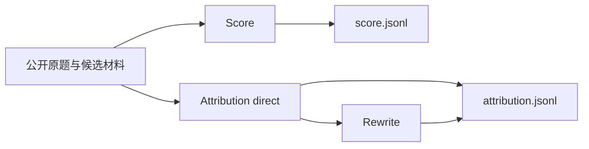

# 独立评分与归因

AIME 使用 `workflow: "answer-review"`。工作台的 AIME 日常来源全量执行 Score 和 Attribution，关闭常规 Rewrite；两阶段互不依赖，评测内容与输入契约保持各自现有定义。Workbench 与增量 CLI 共用同一个执行器、状态锁和每日运行。显式手工 CLI 仍可选择单阶段。



Score 和 Attribution 都不依赖 Criteria，也不读取彼此的结论。两者材料均排除候选系统、开发者提示词。原有比较流程继续使用自己的 Criteria、归因和 Comparison，未改成评分差判胜负。

## Score

评分依据来自用户提供的 `judge_skills/scoring-skill-overview.html` 与 `review-evidence-with-tools`。原始 rubric、scoring、calibration、source-policy 和 question-issue-policy 保存在 [Score 提示资源](../packages/prompts/resources/score/skill/)。正常结果保持原 skill 的七个字段：case_id、final_answer_score、evaluations、findings、evidence、explicit_probability、probability_evidence_ids。

- 总分为独立的0–10整数或待核区间，不由12项相加或平均。
- 12项核心单元为0–4整数或待核区间；24项诊断按固定父子关系嵌套，不单独计分。
- 状态为met、violated、unverified、not_applicable；满分、较低分、区间与不适用按原分档契约校验。程序不代选分数。
- 题目未明确日期时接受候选采用日期；正常对应、参数适当且无相反信号的动作回执按原rubric认可成功。成品质量与整题完成仍分别检查。
- 同一问题只保存一条finding；已恢复过程错误在相应过程项保留，最终有效交付独立评分。
- 共享证据采用Python Unicode码点区间。完整题面缺失、未捕获回答、真实空答及阻断规则冲突保留原异常结构。

宿主适配只涉及工具接口、身份和持久化：使用TypeScript、任务UUID及精确原文坐标，不引入独立Python评测器、哈希指纹、输入副本或独立日志。review_material对应inspect/read/search/quote；review_calculate对应受限复算并登记结果；review_external提供实际搜索、读取与搜索片段准入，保留核验角色和取得内容。默认最多6个底层外部动作、3个完整URL，失败与重定向计入动作；工具不可用或缺证时保留待核。执行器的机械接受不证明语义评分准确。

## Attribution 与 Rewrite

Attribution 的direct配置只让模型提交summary和一层findings。每条finding的component、label、definition与text、reason、evidence_ids同级，不嵌套problem对象；优点的component为空数组、label及definition为null。模型仅引用已取得的证据编号，程序从工具取证账本回填evidence原文及坐标，不要求模型复制证据或手算坐标。

summary、text、reason必须以简体中文叙述；problem 的label、definition也必须为非空中文。strength 的label、definition按契约为null，中文检查将其记为not_applicable（不适用），不计入失败或重试。不能将problem的空字段、缺字段或空字符串当作不适用。专有名词、工具名和真实引文保留原语言。正式归因JSONL将batch_id、case_id、summary、findings、evidence放在顶层，不再套case及evaluation对象。源meta仍按原样保留，不能为了减少嵌套改写用户元数据。

结果验收使用同一语言规则，只读检查，不修改结果、不调用模型：

```bash
npm run attribution:check-language -- --input /mnt/fin_bench/eval_data/1_aime/eval_output/0_daily_eval/1023/results/attribution.jsonl --limit 602
```

省略`--limit`检查整个文件；指定时检查文件前N行。报告按字段分别统计passed、failed、not_applicable，失败项带1起始物理行号及trace_id、task_id。存在真实失败时返回退出码2，全部通过时返回0；读取与文件更新冲突时重新读取完整范围，连续冲突则明确报错。strength的null字段不会触发中文失败。此检查只验收上述点评字段，不替代证据和完整结果Schema校验。

Rewrite只接收summary、问题表述、理由、名称和定义等文本槽位，不接触证据、Score或责任数组。结果作为rewritten附加在归因行，原始判断与已接受Score保持不变。

## 运行

```bash
npm run eval -- preflight --config configs/host.json --config configs/answer-review.json --config /absolute/path/source-and-models.json
npm run eval -- run --run-id answer-review-run --config configs/host.json --config configs/answer-review.json --config /absolute/path/source-and-models.json
```

来源配置可以只包含一个模型，也可包含多个分别独立评审的模式。`--stage score`或`--stage attribution`可只跑一个阶段，新运行及续跑都限定实际调度范围；不加时两阶段并发。同run切换阶段或开启Attribution Rewrite时，补建缺失任务，保留已接受收据和已用额度。模型bindings分别提供score、attribution、rewrite；并发是整个运行的并发上限，不是各阶段分别再乘一次。

`--input ID=PATH`、`--batch`、`--case`和`--limit-cases`沿用公共CLI筛选。`--test-eval`将输出放在同来源的eval_output/test_eval；`--pilot-cases N`同样进入test_eval，按业务题目选择N题及其各模型、所选阶段，完整计划仍保留。普通续跑保留试跑范围，验收后用`--discover-inputs`释放其余已登记回答。`--worker`指定Worker，`--resume-stage`解除指定阶段的熔断，`--skip-failed`保留失败任务，`--balance-channels`沿用渠道分配。日常输出使用本来源的eval_output/0_daily_eval。

`status`、`report`、`validate`通过`--run`读取保存的workflow，不依赖当前模型配置；分别查看状态、生成报告、校验正式结果与收据。

正式结果为results/score.jsonl和results/attribution.jsonl，另有state.json、stats.json和report.md。两份正式输出的顶层meta原样保留源记录的外层meta（包括嵌套值、null及空对象；原记录没有meta时不新增）。它不混入trace.meta，也不发送给裁判。续跑只为缺少meta的已接受结果补齐源meta，已保存的判词、分数和来源字段保持不变，Rewrite同样保留meta。未完成任务重新定位源记录并使用当前题面、最终回答位置和行号；材料坐标变化时丢弃失效草稿与取证账本，保留已用尝试和内容额度。

结果同时直接携带实际回答的trace_id、业务日期、输入文件/行号及原归档/成员/行号/数组项坐标；一般手工输入没有归档坐标时为null。AIME增量入口在清洗阶段要求这些来源完整，见[AIME日常评测](aime-incremental.md)。

工作台单独展示 AIME 的每日运行、分页回答、Score 与 Attribution 正式结果和各阶段错误。首次启动将已有规范输入纳入，沿原每日 run 补齐缺失阶段，已接受结果不重复调用模型。自动恢复按精确任务范围执行，补Score不会连带重开同回答已排除的归因失败。显式失败重试保留task ID、累计尝试和内容账本；提高预算后才允许已达上限任务继续，不解除最终账本安全闸。暂停停止分配新任务，等待当前任务完成；清洗在当前包完成后停住，不打开下一包，继续沿同一 run 执行。停止中断当前执行并保存进度，服务重启等待手动继续。非并发配置在下一次启动或暂停后继续时生效，并发可独立调整；AIME 默认64，不占用问财的32额度。AIME 当前只落盘并在页面查看，不交付 MongoDB，不自动聚类。

快速执行时，公开题面、最终回答及短调用/返回前缀一次提供，未显示后缀明确标记next_start。采集状态按当前A/B消息类型识别，包括无role的reasoning、llm_turn与推理span；无名称的工具返回仍记为已采集工具轨迹。裁判只对影响结论的缺口补查，材料工具支持一次批量读取、检索和取证，直接提交JSON，省去逐条工具往返及写稿轮次。缺证保留待核，12单元、24诊断及原分档不删减。并发仍是运行上限，模型生成速度不由Host保证。

日常可按输入批次日期分别运行，例如本批2026年10月19日至22日使用0_daily_eval/1019至1022，每天各有两份results输出；多个日期同时运行时并发之和为总上限。恢复状态引用正式JSONL，不重复保存已接受正文；新增取证来源随正式结果保存。已接受结果不重新评分，续跑只处理未完成任务。输入契约拒绝的多轮或无效记录保留input issues，不截取或拼接成看似成功的评测。
