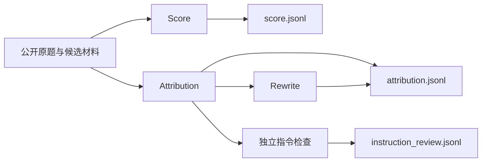

# 独立评分与归因

AIME 使用 `workflow: "answer-review"`。工作台的 AIME 日常来源全量执行 Score 和 Attribution，关闭常规 Rewrite；两阶段互不依赖，评测内容与输入契约保持各自现有定义。Workbench 与增量 CLI 共用同一个执行器、状态锁和每日运行。显式手工 CLI 仍可选择单阶段。

全部归因结束后可使用[独立聚类命令](usage.md#独立核验与聚类)冻结本次归因来源，沿用各阶段自己的状态和正式结果契约。聚类完成后输出 `cluster_tree.jsonl` 和独立的 `state.json`；树保留已归类、待观察问题以及无问题回答的覆盖范围，不修改评分或归因结果。

独立评测自行规划任务，配置只包含输入、执行预算、输出、归因润色开关与阶段选择，不要求对战组、聚类或问题库设置。来源编目和按坐标重读使用 `@eval/workflows/inputs`，归因与指令检查共用材料使用 `@eval/workflows/review`；共用模块不依赖对战规划或运行状态。



Score 和 Attribution 都不依赖 Criteria，也不读取彼此的结论。两者材料均排除候选系统、开发者提示词。原有比较流程继续使用自己的 Criteria、归因和 Comparison，未改成评分差判胜负。

## Score

已在初始材料展示的题面、回答及过程片段由程序预登记精确引文坐标，取证会话可直接选用编号；这不证明事实正确或完整，未展示后缀与关键缺口仍须核验。同阶段后续评分任务优先于新的独立任务收尾，阶段之间继续共享并发额度。

Score对外接收单题材料并返回一个JSON，内部使用同一Agent的多个profile：统一取证与复算 → 六轴联合评分 → 独立总分。正常执行3次会话，六轴各按原锚点判断，在一个会话中共用事实推理。总分仍是独立会话，不读取分项数值，也不平均或逐项扣分，并重新核查交付与问题的支持关系。

评分含义沿用[原skill规则](../packages/prompts/resources/score/skill/)。总分0–10、12核心单元0–4、24诊断不另计分；过程错误恢复与最终有效交付分别评价。待核使用有宽度区间，不适用不补0；无原文证据的元信息依据须使用以/开头的JSON Pointer及对应原值。题目未明示日期时接受候选采用日期，正常对应的行动回执按原rubric认可成功。

正常结果有八个顶层字段：case_id、final_answer_score、evaluations、diagnostics、findings、evidence、explicit_probability、probability_evidence_ids。12核心项与24诊断使用平级数组，固定父子关系仍逐轴校验。模型只提交实际判断和证据编号，程序补身份、固定名称、分档和准确Unicode码点引文。统一取证的编号保持稳定，联合收据按轴投影并复用原判词；定向重评新增证据按原文坐标去重并消解局部编号冲突。总分轮仅将同一问题分组，程序合并编号及引用，不改六轴判断或丢弃问题。
各阶段的提交修复均替换完整对象，不能提交局部字段补丁；评分阶段仍须完整交付其指定轴的全部核心项、诊断及问题/缺口数组。空的可选字段省略，不靠兼容或静默补齐语义字段通过校验。

统一取证只提交事实所对应的证据编号、受影响核心项及待查缺口，不预先判定回答对错。评分阶段只接收facts；自由文本的unresolved仅用于取证恢复，不传给六轴或总分。来源正文按需读取，联合评分核对主张与证据的对象、时间、范围、口径和完整限定语，再提请关键缺口。公开问题给定且兼容的前提可用于条件分析，不因缺少独立实时数据自动扣分；已保留未知的回答不因未穷尽空查询的所有可能原因而扣分，零条返回也不等于查询未执行。各阶段只装配自身负责的原skill规则，六轴不再分为独立会话；12核心项、24诊断及适用、待核、异常语义保留，独立总分边界不变。

Score使用score_material批量读取、检索和引用材料；quote可直接使用已读片段的Unicode码点start/end，程序提取原文，关键数值、日期和条件须完整包含。score_calculate.inputs的evidence_id使用已登记EV编号，程序展开来源、原文与坐标，复算后自动登记V_CALC及结果证据，不要求模型重复抄写输入原文。只复算影响判断的关键推导，失败不以心算冒充成功。复算不认证输入口径，裁判填写的role和表达式不是原字段语义的证据；自行年化或补假设不能替代候选实际采用的期间、单位与公式，也不能补认候选已恢复。对象、币种或周期错配须沿共享依据检查受影响的指标、阈值与结论，不能默认错误只限于一句表述。

score_external使用与Eris相同的Serper搜索，摘要不足再读取原文。SEARCH_API_KEY通过既有配置注入；Score显式使用环境代理，不依赖SDK更换后的全局dispatcher。读取仍校验公共DNS并固定实际连接IP，保留原始Host和TLS主机名，代理旁路按原始域名匹配；不改变其他Agent的网络实现。全题最多6个底层外部请求、3个来源URL，失败和重定向计入，补查不重置预算。

关键新缺口统一补查一次，按新增事实关联的核心项定向重评所属轴，复用联合收据中其余轴的判断；没有新增事实时不重跑分项，剩余缺证保留待核。确有新事实而影响无法隔离时，取证阶段须说明full_rescore_reason，再联合重评六轴；重复旧引用不能触发全量重评。同一问题或缺口关联多个轴时，将关联轴一起重评，避免程序擅自裁剪问题或更改主诊断。单轴使用axis profile，多轴在一次dimensions会话中只重评指定子集。真正跨轴矛盾最多定向重评一次，仍不一致则拒收，不由总分轮覆盖分项。

只有最终结果（或原skill异常对象）写入score.jsonl。中间片段仅作续跑草稿，完成后状态只保留结果引用与进度。公开题面缺失、回答未采集、真实空答和阻断规则冲突保留原异常结构，不伪造评分。结构合法不证明语义准确。

来源验收区分标题/摘要实际支持的属性、待核存续状态与网站条款日期，不把有限核验一概视为无支持；查询字段名称不证明数据库全量覆盖。总分轮核对已确认问题与统一核验及实际引文的确定性，发现同一事实无实证却被确认为错误时，走定向重评或拒收，不靠总分理由中的待核说明掩盖。补查后提交Schema禁止再次请求补查，仍可在独立额度内请求一次定向重评。

## Attribution 与 Rewrite

链路读取校验同时认可已实际交付的完整 JSON 字符串叶子；可拼接同一物理来源的相邻读取，但不借用其他路径、消息或初始预览，也不把不完整序列化片段视为完整文本。原始引文和责任仍按各自坐标校验。

Attribution 与 comparison 使用同一default入口，Workflow适配来源及业务身份。结果包含summary、findings、criterion_assessments、core_assessment、正确性与数值核验；问题描述位于finding.problem，优点的problem为null。每个问题的component是责任对象数组，恰有一个primary主责，可有contributing关联责任。各责任独立记录技术域、二级功能、实际组件、环节、中文机制、确证或推断、理由及证据；推断必须给出关键缺口和替代解释。缺陷的established/uncertain与责任的confirmed/inferred分别判断，已确认问题不因因果材料不足降级，也不能以空责任结束。目录唯一来源为[技术目录](../packages/prompts/resources/attribution/taxonomy.json)。

业务责任另记录 `business_component`（具体业务处理位置）、`chain_index`（本次调用）、`chain_step`（业务环节）、`field_names`（原文中的字段）和 `mechanism_source`。实际组件、技术分类、调用坐标分别表达，不能只用“最终作答节点”结束定位。Workflow 的 `answer.business_chains` 按明确调用 ID 或唯一返回 query 关联请求和返回，规划者须有唯一父 span 关联；不按相邻位置猜配。目录按用户目标、查询规划与标的选择、工具请求参数、原始返回及字段含义、返回整理与上下文传递、模型实际输入、数据解释与计算、核验与最终交付登记原始证据。英文、中文当前检索和金融结果区都建立交付来源索引，历史和背景控制文案不进入该目录。业务链路另追踪已关联整理节点的实际输入和输出，以定位传递丢失；较早记录不冒充最后实际输入，也不自动变成当前交付的合格来源。

问题的 `diagnosis` 区分标的/单位、来源缺失、上下文丢失及其他，`investigation` 保存相关链路八步观察和证据。被引用链路的规划、请求、返回、实际输入必须实际读取；必要读取支持原文叶子与根 JSON 的精确字段区间，短字段只读取完整剩余区间，不能拆成任意小片段透支额度；Host 与 Worker 按相同类型、坐标及页数核对。必要读取使用独立受保护预算，主归因和后置指令检查仍共享服务器并发上限。已存在但未读的材料不能记为未采集；校验退回继续取证。检查点只导航，不判因果，也不能用结构通过替代语义审阅。来源存在但不支持某主张时追查解释及使用，不能改判来源不存在。

缺陷成立和机制确定性分别记录。`explicit_process` 表示实际处理记录直接显示动作；`boundary_comparison` 只能标 `inferred` 并列缺口及替代解释。每步 checked 必须引用该环节原始来源；传递、解释和交付分别引用前后边界。实际输入必须包含最后生成节点的快照，不能用较早的整理节点输入代替。模型的 explicit_process 须有被引用的中间推理或计算记录，只有输入输出时拒绝该标记。ETF返回369、现货交付3690能够确证错配，未记录算式时不能确证内部执行了十倍换算。主责解释缺陷形成，关联责任须有独立传播或恢复作用；按请求正确返回的工具、未经证实错误的代理标的规划均不自动有责。Clustering 示例保留业务位置、调用、字段及机制依据，正式导出保留完整调查与原始证据；不增加旧字段兼容入口。

归因正文与确定性字段保持一致：未记录换算或核验不证明动作未执行，隐藏动作在摘要、观察和机制中同样保留推断。归因自身的倍率、舍入和影响范围也须核验；近似关系不能声称精确相等，单个价格锚点错误不能外推为全部技术位按同一比例错误。`field_names` 只记录所选原文或坐标中的实际字段名，普通正文计算没有结构化字段时可填空数组；校验反馈给出可保留的字段，不自动改写提交，也不建议标的、单位或上下文问题清空必需字段。

代理资产的走势参考与目标资产实际报价分别验收。跨资产或单位的实际报价须有本次转换规则、参数和日期依据，不能用常识比例填补证据缺口；缺少支持时确认具体报价的引用口径缺陷，不因此自动追责代理选择或工具实现。调查修复反馈提供当前嵌套 Schema 与链路索引，证据统一使用账本 reference 选号；尚未登记的来源提供读取导航，不让模型手拼原始证据 ID。

主归因只读取公开原题、交付、验收要求、参考及过程事实。SYS/DEV和已确认加载的Skill规范从模型材料及可读来源同时排除；原始来源保留在Workflow用于后置独立会话。证据仍由账本生成编号、校验原文坐标并回填，模型选择编号，不复制引文或手算坐标。

Workflow提供`answer.component_catalog`身份目录，独立于技术域和二级功能分类。实际组件优先沿用轨迹明确给出的节点、Agent、工具或服务名；`llm-call-*`、span ID、UUID等只在调用关联和证据导航中保留。缺名但能确认最终生成关系时使用“最终作答节点（原始名称未提供）”；连职责角色也缺失时明确注明身份缺口，不推测业务名称或模型型号。多条匿名或同名模型记录分别定位，不合并成通用“回答模型”。Agent只选择目录中的名称，程序校验目录与原始事实的对应关系；名称通过目录的`message_indices`和`identity_evidence`关联回实际节点。正式责任、导出与聚类样本保留所选实际名称和既有证据引用，技术分类仍单独分桶。

调用目录用semantic_role区分模型节点和工具记录；唯一明确的parent_span关联提供invoking_model_message_index导航，缺失或歧义时不猜配。已加载Skill在输入快照中的原文副本同样排除，未改写的事实叶保留原始坐标。

每条主归因被接受后自动创建instruction-review任务，使用独立会话检查规则适用条件、例外及实际行为，缺证标unverified。结果写入results/instruction_review.jsonl，带source_attribution_task_id与独立instruction_review、证据及核验账本；不改写主归因和Comparison。后置失败保留已接受主归因，续跑只处理未完成任务。主归因与后置任务共用Host总并发。

summary、text、reason以及problem的label、definition采用简体中文，专有名词及真实引文保留原语言。正式归因JSONL在顶层保存完整归因结果与来源元信息，证据位于对应finding或正确性核验中。源meta原样保留，仅用于导出。

结果验收使用同一语言规则，只读检查，不修改结果、不调用模型：

```bash
npm run attribution:check-language -- --input /path/to/attribution.jsonl --limit 100
```

省略`--limit`检查整个文件；指定时检查文件前N行。报告按字段分别统计passed、failed、not_applicable，失败项带1起始物理行号及trace_id、task_id。存在真实失败时返回退出码2，全部通过时返回0；读取与文件更新冲突时重新读取完整范围，连续冲突则明确报错。strength的null字段不会触发中文失败。此检查只验收上述点评字段，不替代证据和完整结果Schema校验。

Rewrite只接收summary、问题表述、理由、名称和定义等文本槽位，不接触证据、Score或责任数组。结果作为rewritten附加在归因行，原始判断与已接受Score保持不变。

## 运行

```bash
npm run eval -- preflight --config configs/host.json --config configs/answer-review.json --config /absolute/path/source-and-models.json
npm run eval -- run --run-id answer-review-run --config configs/host.json --config configs/answer-review.json --config /absolute/path/source-and-models.json
```

来源配置可以只包含一个模型，也可包含多个分别独立评审的模式。`--stage score`或`--stage attribution`可只跑一个阶段，新运行及续跑都限定实际调度范围；不加时两阶段并发，Score内部阶段也受同一运行并发上限约束。同run切换阶段或开启Attribution Rewrite时，补建缺失任务，保留已接受收据和已用额度。模型bindings分别提供score、attribution、instruction-review、rewrite；并发是整个运行的并发上限，不是各阶段分别再乘一次。

`--input ID=PATH`、`--batch`、`--case`和`--limit-cases`沿用公共CLI筛选。`--test-eval`将输出放在同来源的eval_output/test_eval；`--pilot-cases N`同样进入test_eval，按业务题目选择N题及其各模型、所选阶段，完整计划仍保留。普通续跑保留试跑范围，验收后用`--discover-inputs`释放其余已登记回答。`--worker`指定Worker，`--resume-stage`解除指定阶段的熔断，`--skip-failed`保留失败任务，`--balance-channels`沿用渠道分配。日常输出使用本来源的eval_output/0_daily_eval。

`status`、`report`、`validate`通过`--run`读取保存的workflow，不依赖当前模型配置；分别查看状态、生成报告、校验正式结果与收据。

正式结果为results/score.jsonl、results/attribution.jsonl和results/instruction_review.jsonl，另有state.json、stats.json和report.md。正式输出的顶层meta原样保留源记录的外层meta（包括嵌套值、null及空对象；原记录没有meta时不新增）。它不混入trace.meta，也不发送给裁判。续跑只为缺少meta的已接受结果补齐源meta，已保存的判词、分数和来源字段保持不变，Rewrite同样保留meta。未完成任务重新定位源记录并使用当前题面、最终回答位置和行号；材料坐标变化时丢弃失效草稿与取证账本，保留已用尝试和内容额度。

结果同时直接携带实际回答的trace_id、业务日期、输入文件/行号及原归档/成员/行号/数组项坐标；一般手工输入没有归档坐标时为null。AIME增量入口在清洗阶段要求这些来源完整，见[AIME日常评测](aime-incremental.md)。

工作台按回答统计 AIME 的每日运行和覆盖率，Score 仅在正式终局结果接受后计为完成，取证与分项任务不单独计数。Score 与主归因成功即计为回答完成；独立指令检查使用独立模型绑定并另列状态和结果，失败可单独重试，不重跑或改写已接受主归因。整体运行仍跟踪后置任务的失败与暂停。列表、详情、统计和定向重试采用相同口径。首次启动将已有规范输入纳入，沿原每日 run 补齐缺失阶段，已接受结果不重复调用模型。自动恢复按精确任务范围执行，补Score不会连带重开同回答已排除的归因失败。显式失败重试保留task ID、累计尝试和内容账本；提高预算后才允许已达上限任务继续，不解除最终账本安全闸。暂停停止分配新任务，等待当前任务完成；清洗在当前包完成后停住，不打开下一包，继续沿同一 run 执行。停止中断当前执行并保存进度，服务重启等待手动继续。非并发配置在下一次启动或暂停后继续时生效，并发可独立调整；AIME 默认64，不占用问财的32额度。AIME 当前只落盘并在页面查看，不交付 MongoDB，不自动聚类。

快速执行时，公开题面、最终回答及短调用/返回前缀一次提供，未显示后缀明确标记next_start。采集状态按当前A/B消息类型识别，包括无role的reasoning、llm_turn与推理span；无名称的工具返回仍记为已采集工具轨迹。裁判只对影响结论的缺口补查，材料工具支持一次批量读取、检索和取证，Score直接提交JSON，Attribution通过文件提交当前完整判断。缺证保留待核，12单元、24诊断及原分档不删减。并发仍是运行上限，模型生成速度不由Host保证。

每日运行目录与增量追加规则见[AIME日常评测](aime-incremental.md#输入结果与运行状态)。恢复状态引用正式JSONL，不重复保存已接受正文；新增取证来源随正式结果保存。输入契约拒绝的多轮或无效记录保留input issues，不截取或拼接成看似成功的评测。
