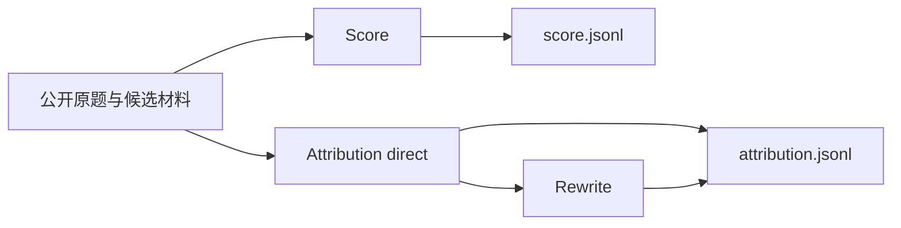

# 独立评分与归因

AIME 使用 `workflow: "answer-review"`。当前日常运行选择 `--stage attribution`，关闭Score和常规Rewrite，优先产出中文归因。Score仍可按需单独运行；两阶段互不依赖。



Score 和 Attribution 都不依赖 Criteria，也不读取彼此的结论。两者材料均排除候选系统、开发者提示词。原有比较流程继续使用自己的 Criteria、归因和 Comparison，未改成评分差判胜负。

## Score

Score对外接收单题材料并返回一个JSON，内部使用同一Agent的多个profile：统一取证与复算 → T/E/L/A/U/D六轴独立会话 → 独立总分。正常执行8次会话，六轴共享固定证据，不读取彼此判词。总分不读取六轴数值分数，也不平均或逐项扣分。

评分含义沿用[原skill规则](../packages/prompts/resources/score/skill/)。总分0–10、12核心单元0–4、24诊断不另计分；过程错误恢复与最终有效交付分别评价。待核使用有宽度区间，不适用不补0；无原文证据的元信息依据须使用以/开头的JSON Pointer及对应原值。题目未明示日期时接受候选采用日期，正常对应的行动回执按原rubric认可成功。

正常结果有八个顶层字段：case_id、final_answer_score、evaluations、diagnostics、findings、evidence、explicit_probability、probability_evidence_ids。12核心项与24诊断使用平级数组，固定父子关系仍校验。模型只提交实际判断和证据编号，程序补身份、固定名称、分档和准确Unicode码点引文。统一取证的编号保持稳定，六轴新增证据按原文坐标去重并消解局部编号冲突。总分轮仅将同一问题分组，程序合并编号及引用，不改六轴判断或丢弃问题。

统一取证只提交事实所对应的证据编号、受影响核心项及待查缺口，不预先判定回答对错。评分阶段只接收facts；自由文本的unresolved仅用于取证恢复，不传给六轴或总分。来源正文按需读取，各轴独立核对主张与证据的对象、时间、范围、口径和推论，再自行提请关键缺口。公开问题给定且兼容的前提可用于条件分析，不因缺少独立实时数据自动扣分。各阶段只装配自身负责的原skill规则，六轴判断和独立总分边界不变。

Score使用score_material批量读取、检索和引用材料；quote可直接使用已读片段的Unicode码点start/end，程序提取原文。score_calculate.inputs的evidence_id使用已登记EV编号，程序展开来源、原文与坐标，复算后自动登记V_CALC及结果证据，不要求模型重复抄写输入原文。只复算影响判断的关键推导，失败不以心算冒充成功。

score_external使用与Eris相同的Serper搜索，摘要不足再读取原文。SEARCH_API_KEY通过既有配置注入；Score显式使用环境代理，不依赖SDK更换后的全局dispatcher。读取仍校验公共DNS并固定实际连接IP，保留原始Host和TLS主机名，代理旁路按原始域名匹配；不改变其他Agent的网络实现。全题最多6个底层外部请求、3个来源URL，失败和重定向计入，补查不重置预算。

关键新缺口统一补查一次，按新增事实关联的核心项定向重评所属轴，复用其余轴的收据；没有新增事实时不重跑分项，剩余缺证保留待核。确有新事实而影响无法隔离时，取证阶段须说明full_rescore_reason，再重评六轴。真正跨轴矛盾最多定向重评一次，仍不一致则拒收，不由总分轮覆盖分项。

只有最终结果（或原skill异常对象）写入score.jsonl。中间片段仅作续跑草稿，完成后状态只保留结果引用与进度。公开题面缺失、回答未采集、真实空答和阻断规则冲突保留原异常结构，不伪造评分。结构合法不证明语义准确。

来源验收区分标题/摘要实际支持的属性、待核存续状态与网站条款日期，不把有限核验一概视为无支持；查询字段名称不证明数据库全量覆盖。总分轮核对已确认问题与统一核验及实际引文的确定性，发现同一事实无实证却被确认为错误时，走定向重评或拒收，不靠总分理由中的待核说明掩盖。补查后提交Schema禁止再次请求补查，仍可在独立额度内请求一次定向重评。

## Attribution 与 Rewrite

Attribution 的direct配置只让模型提交summary和一层findings。每条finding的component、label、definition与text、reason、evidence_ids同级，不嵌套problem对象；优点的component为空数组、label及definition为null。模型仅引用已取得的证据编号，程序从工具取证账本回填evidence原文及坐标，不要求模型复制证据或手算坐标。

summary、text、reason必须以简体中文叙述；problem 的label、definition也必须为非空中文。strength 的label、definition按契约为null，中文检查将其记为not_applicable（不适用），不计入失败或重试。不能将problem的空字段、缺字段或空字符串当作不适用。专有名词、工具名和真实引文保留原语言。正式归因JSONL将batch_id、case_id、summary、findings、evidence放在顶层，不再套case及evaluation对象。源meta仍按原样保留，不能为了减少嵌套改写用户元数据。

结果验收使用同一语言规则，只读检查，不修改结果、不调用模型：

```bash
npm run attribution:check-language -- --input /mnt/fin_bench/eval_data/1_aime/eval_output/0_daily_eval/1023/results/attribution.jsonl --limit 602
```

省略`--limit`检查整个文件；指定时检查文件前N行。报告按字段分别统计passed、failed、not_applicable，失败项带1起始物理行号及trace_id、task_id。存在真实失败时返回退出码2，全部通过时返回0；读取与文件更新冲突时重新读取完整范围，连续冲突则明确报错。strength的null字段不会触发中文失败。此检查只验收上述点评字段，不替代证据和完整结果Schema校验。

Rewrite只接收summary、问题表述、理由、名称和定义等文本槽位，不接触证据、Score或责任数组。结果作为rewritten附加在归因行，原始判断与已接受Score保持不变。

## 运行

```bash
npm run eval -- preflight --stage attribution --config configs/host.json --config configs/answer-review.json --config /absolute/path/source-and-models.json
npm run eval -- run --stage attribution --run-id answer-review-run --config configs/host.json --config configs/answer-review.json --config /absolute/path/source-and-models.json
```

来源配置可以只包含一个模型，也可包含多个分别独立评审的模式。`--stage score`或`--stage attribution`可只跑一个阶段，新运行及续跑都限定实际调度范围；不加时两阶段并发，Score内部六轴也受同一运行并发上限约束。同run切换阶段或开启Attribution Rewrite时，补建缺失任务，保留已接受收据和已用额度。模型bindings分别提供score、attribution、rewrite；并发是整个运行的并发上限，不是各阶段分别再乘一次。

`--input ID=PATH`、`--batch`、`--case`和`--limit-cases`沿用公共CLI筛选。`--test-eval`将输出放在同来源的eval_output/test_eval；`--pilot-cases N`同样进入test_eval，按业务题目选择N题及其各模型、所选阶段，完整计划仍保留。普通续跑保留试跑范围，验收后用`--discover-inputs`释放其余已登记回答。`--worker`指定Worker，`--resume-stage`解除指定阶段的熔断，`--skip-failed`保留失败任务，`--balance-channels`沿用渠道分配。日常输出使用本来源的eval_output/0_daily_eval。

`status`、`report`、`validate`通过`--run`读取保存的workflow，不依赖当前模型配置；分别查看状态、生成报告、校验正式结果与收据。

正式结果为results/score.jsonl和results/attribution.jsonl，另有state.json、stats.json和report.md。两份正式输出的顶层meta原样保留源记录的外层meta（包括嵌套值、null及空对象；原记录没有meta时不新增）。它不混入trace.meta，也不发送给裁判。续跑只为缺少meta的已接受结果补齐源meta，已保存的判词、分数和来源字段保持不变，Rewrite同样保留meta。未完成任务重新定位源记录并使用当前题面、最终回答位置和行号；材料坐标变化时丢弃失效草稿与取证账本，保留已用尝试和内容额度。

结果同时直接携带实际回答的trace_id、业务日期、输入文件/行号及原归档/成员/行号/数组项坐标；一般手工输入没有归档坐标时为null。AIME增量入口在清洗阶段要求这些来源完整，见[AIME增量归因](aime-incremental.md)。

快速执行时，公开题面、最终回答及短调用/返回前缀一次提供，未显示后缀明确标记next_start。采集状态按当前A/B消息类型识别，包括无role的reasoning、llm_turn与推理span；无名称的工具返回仍记为已采集工具轨迹。裁判只对影响结论的缺口补查，材料工具支持一次批量读取、检索和取证，直接提交JSON，省去逐条工具往返及写稿轮次。缺证保留待核，12单元、24诊断及原分档不删减。并发仍是运行上限，模型生成速度不由Host保证。

日常可按输入批次日期分别运行，例如本批2026年10月19日至22日使用0_daily_eval/1019至1022，每天各有两份results输出；多个日期同时运行时并发之和为总上限。恢复状态引用正式JSONL，不重复保存已接受正文；新增取证来源随正式结果保存。已接受结果不重新评分，续跑只处理未完成任务。输入契约拒绝的多轮或无效记录保留input issues，不截取或拼接成看似成功的评测。
