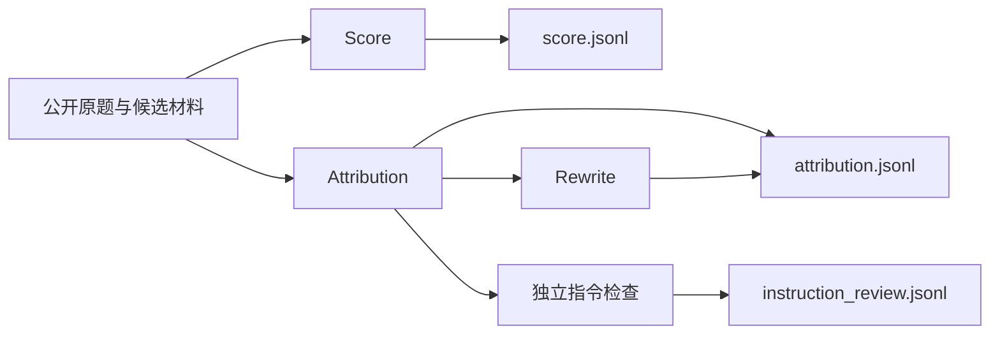

# 独立评分与归因

AIME 使用 `workflow: "answer-review"`。当前日常运行选择 `--stage attribution`，关闭Score和常规Rewrite，优先产出中文归因。Score仍可按需单独运行；两阶段互不依赖。



Score 和 Attribution 都不依赖 Criteria，也不读取彼此的结论。两者材料均排除候选系统、开发者提示词。原有比较流程继续使用自己的 Criteria、归因和 Comparison，未改成评分差判胜负。

## Score

评分依据来自用户提供的 `judge_skills/scoring-skill-overview.html` 与 `review-evidence-with-tools`。原始 rubric、scoring、calibration、source-policy 和 question-issue-policy 保存在 [Score 提示资源](../packages/prompts/resources/score/skill/)。正常结果保持原 skill 的七个字段：case_id、final_answer_score、evaluations、findings、evidence、explicit_probability、probability_evidence_ids。

- 总分为独立的0–10整数或待核区间，不由12项相加或平均。
- 12项核心单元为0–4整数或待核区间；24项诊断按固定父子关系嵌套，不单独计分。
- 状态为met、violated、unverified、not_applicable；满分、较低分、区间与不适用按原分档契约校验。程序不代选分数。
- 题目未明确日期时接受候选采用日期；正常对应、参数适当且无相反信号的动作回执按原rubric认可成功。成品质量与整题完成仍分别检查。
- 同一问题只保存一条finding；已恢复过程错误在相应过程项保留，最终有效交付独立评分。
- 共享证据采用Python Unicode码点区间。完整题面缺失、未捕获回答、真实空答及阻断规则冲突保留原异常结构。

宿主适配只涉及工具接口、身份和持久化：使用TypeScript、任务UUID及精确原文坐标，不引入独立Python评测器、哈希指纹、输入副本或独立日志。review_material对应inspect/read/search/quote；review_calculate对应受限复算并登记结果；review_external提供实际搜索、读取与搜索片段准入，保留核验角色和取得内容。默认最多6个底层外部动作、3个完整URL，失败与重定向计入动作；工具不可用或缺证时保留待核。执行器的机械接受不证明语义评分准确。

## Attribution 与 Rewrite

Attribution 与 comparison 使用同一default入口，Workflow适配来源及业务身份。结果包含summary、findings、criterion_assessments、core_assessment、正确性与数值核验；问题描述位于finding.problem，优点的problem为null。每个问题的component是责任对象数组，恰有一个primary主责，可有contributing关联责任。各责任独立记录技术域、二级功能、实际组件、环节、中文机制、确证或推断、理由及证据；推断必须给出关键缺口和替代解释。缺陷的established/uncertain与责任的confirmed/inferred分别判断，已确认问题不因因果材料不足降级，也不能以空责任结束。目录唯一来源为[技术目录](../packages/prompts/resources/attribution/taxonomy.json)。

业务责任另记录 `business_component`（具体业务处理位置）、`chain_index`（本次调用）、`chain_step`（业务环节）、`field_names`（原文中的字段）和 `mechanism_source`。实际组件、技术分类、调用坐标分别表达，不能只用“最终作答节点”结束定位。Workflow 的 `answer.business_chains` 按明确调用 ID 或唯一返回 query 关联请求和返回，规划者须有唯一父 span 关联；不按相邻位置猜配。目录按用户目标、查询规划与标的选择、工具请求参数、原始返回及字段含义、返回整理与上下文传递、模型实际输入、数据解释与计算、核验与最终交付登记原始证据。英文、中文当前检索和金融结果区都建立来源索引，历史和背景控制文案不进入来源目录。

问题的 `diagnosis` 区分标的/单位、来源缺失、上下文丢失及其他，`investigation` 保存相关链路八步观察和证据。被引用链路的规划、请求、返回、实际输入必须实际读取；必要读取使用独立受保护预算，主归因和后置指令检查仍共享服务器并发上限。已存在但未读的材料不能记为未采集；校验退回继续取证。检查点只导航，不判因果，也不能用结构通过替代语义审阅。来源存在但不支持某主张时追查解释及使用，不能改判来源不存在。

缺陷成立和机制确定性分别记录。`explicit_process` 表示实际处理记录直接显示动作；`boundary_comparison` 只能标 `inferred` 并列缺口及替代解释。ETF返回369、现货交付3690能够确证错配，未记录算式时不能确证内部执行了十倍换算。主责解释缺陷形成，关联责任须有独立传播或恢复作用；按请求正确返回的工具、未经证实错误的代理标的规划均不自动有责。Clustering 示例保留业务位置、调用、字段及机制依据，正式导出保留完整调查与原始证据；不增加旧字段兼容入口。

主归因只读取公开原题、交付、验收要求、参考及过程事实。SYS/DEV和已确认加载的Skill规范从模型材料及可读来源同时排除；原始来源保留在Workflow用于后置独立会话。证据仍由账本生成编号、校验原文坐标并回填，模型选择编号，不复制引文或手算坐标。

Workflow提供`answer.component_catalog`身份目录，独立于技术域和二级功能分类。实际组件优先沿用轨迹明确给出的节点、Agent、工具或服务名；`llm-call-*`、span ID、UUID等只在调用关联和证据导航中保留。缺名但能确认最终生成关系时使用“最终作答节点（原始名称未提供）”；连职责角色也缺失时明确注明身份缺口，不推测业务名称或模型型号。多条匿名或同名模型记录分别定位，不合并成通用“回答模型”。Agent只选择目录中的名称，程序校验目录与原始事实的对应关系；名称通过目录的`message_indices`和`identity_evidence`关联回实际节点。正式责任、导出与聚类样本保留所选实际名称和既有证据引用，技术分类仍单独分桶。

调用目录用semantic_role区分模型节点和工具记录；唯一明确的parent_span关联提供invoking_model_message_index导航，缺失或歧义时不猜配。已加载Skill在输入快照中的原文副本同样排除，未改写的事实叶保留原始坐标。

每条主归因被接受后自动创建instruction-review任务，使用独立会话检查规则适用条件、例外及实际行为，缺证标unverified。结果写入results/instruction_review.jsonl，带source_attribution_task_id与独立instruction_review、证据及核验账本；不改写主归因和Comparison。后置失败保留已接受主归因，续跑只处理未完成任务。主归因与后置任务共用Host总并发。

summary、text、reason以及problem的label、definition采用简体中文，专有名词及真实引文保留原语言。正式归因JSONL在顶层保存完整归因结果与来源元信息，证据位于对应finding或正确性核验中。源meta原样保留，仅用于导出。

结果验收使用同一语言规则，只读检查，不修改结果、不调用模型：

```bash
npm run attribution:check-language -- --input /mnt/fin_bench/eval_data/1_aime/eval_output/0_daily_eval/1023/results/attribution.jsonl --limit 602
```

省略`--limit`检查整个文件；指定时检查文件前N行。报告按字段分别统计passed、failed、not_applicable，失败项带1起始物理行号及trace_id、task_id。存在真实失败时返回退出码2，全部通过时返回0；读取与文件更新冲突时重新读取完整范围，连续冲突则明确报错。strength的null字段不会触发中文失败。此检查只验收上述点评字段，不替代证据和完整结果Schema校验。

Rewrite只接收summary、问题表述、理由、名称和定义等文本槽位，不接触证据、Score或责任数组。结果作为rewritten附加在归因行，原始判断与已接受Score保持不变。

## 运行

```bash
npm run eval -- preflight --stage attribution --config configs/host.json --config configs/answer-review.json --config /absolute/path/source-and-models.json
npm run eval -- run --stage attribution --run-id answer-review-run --config configs/host.json --config configs/answer-review.json --config /absolute/path/source-and-models.json
```

来源配置可以只包含一个模型，也可包含多个分别独立评审的模式。`--stage score`或`--stage attribution`可只跑一个阶段，新运行及续跑都限定实际调度范围；不加时两阶段并发。同run切换阶段或开启Attribution Rewrite时，补建缺失任务，保留已接受收据和已用额度。模型bindings分别提供score、attribution、instruction-review、rewrite；并发是整个运行的并发上限，不是各阶段分别再乘一次。

`--input ID=PATH`、`--batch`、`--case`和`--limit-cases`沿用公共CLI筛选。`--test-eval`将输出放在同来源的eval_output/test_eval；`--pilot-cases N`同样进入test_eval，按业务题目选择N题及其各模型、所选阶段，完整计划仍保留。普通续跑保留试跑范围，验收后用`--discover-inputs`释放其余已登记回答。`--worker`指定Worker，`--resume-stage`解除指定阶段的熔断，`--skip-failed`保留失败任务，`--balance-channels`沿用渠道分配。日常输出使用本来源的eval_output/0_daily_eval。

`status`、`report`、`validate`通过`--run`读取保存的workflow，不依赖当前模型配置；分别查看状态、生成报告、校验正式结果与收据。

正式结果为results/score.jsonl、results/attribution.jsonl和results/instruction_review.jsonl，另有state.json、stats.json和report.md。正式输出的顶层meta原样保留源记录的外层meta（包括嵌套值、null及空对象；原记录没有meta时不新增）。它不混入trace.meta，也不发送给裁判。续跑只为缺少meta的已接受结果补齐源meta，已保存的判词、分数和来源字段保持不变，Rewrite同样保留meta。未完成任务重新定位源记录并使用当前题面、最终回答位置和行号；材料坐标变化时丢弃失效草稿与取证账本，保留已用尝试和内容额度。

结果同时直接携带实际回答的trace_id、业务日期、输入文件/行号及原归档/成员/行号/数组项坐标；一般手工输入没有归档坐标时为null。AIME增量入口在清洗阶段要求这些来源完整，见[AIME增量归因](aime-incremental.md)。

快速执行时，公开题面、最终回答及短调用/返回前缀一次提供，未显示后缀明确标记next_start。采集状态按当前A/B消息类型识别，包括无role的reasoning、llm_turn与推理span；无名称的工具返回仍记为已采集工具轨迹。裁判只对影响结论的缺口补查，材料工具支持一次批量读取、检索和取证，Score直接提交JSON，Attribution通过文件提交当前完整判断。缺证保留待核，12单元、24诊断及原分档不删减。并发仍是运行上限，模型生成速度不由Host保证。

日常可按输入批次日期分别运行，例如本批2026年10月19日至22日使用0_daily_eval/1019至1022，每天各有两份results输出；多个日期同时运行时并发之和为总上限。恢复状态引用正式JSONL，不重复保存已接受正文；新增取证来源随正式结果保存。已接受结果不重新评分，续跑只处理未完成任务。输入契约拒绝的多轮或无效记录保留input issues，不截取或拼接成看似成功的评测。
