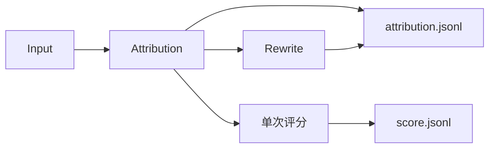

# 单样本归因与评分

AIME 使用 workflow: answer-review。每条回答先完成 Attribution，通过后立即启动一次 Score；不同回答持续共享总并发。评分将已接受归因作为事实依据，不能复核、改写或退回归因。Workbench 与增量 CLI 共用执行器和状态锁，常规 Rewrite 关闭。

全部归因结束后可使用[独立聚类命令](usage.md#独立核验与聚类)冻结本次归因来源，沿用各阶段自己的状态和正式结果契约。聚类完成后输出 `cluster_tree.jsonl` 和独立的 `state.json`；树保留已归类、待观察问题以及无问题回答的覆盖范围，不修改评分或归因结果。

独立评测自行规划任务，配置只包含输入、执行预算、输出、归因润色开关与阶段选择，不要求对战组、聚类或问题库设置。来源编目和按坐标重读使用 `@eval/workflows/inputs`，归因与指令检查共用材料使用 `@eval/workflows/review`；共用模块不依赖对战规划或运行状态。



Score 和 Attribution 不依赖 Criteria，均排除候选 SYS/DEV。原比较流程继续使用自己的 Criteria、归因和 Comparison。

## Score

评分输入为原题、完整最终回答，以及程序整理的必要交付完成情况、问题、实际影响、缺陷确定性、责任机制确定性和必要引文目录。公共事实只保留一次，不复制长轨迹或八步调查；归因中已确认、待核和已恢复状态原样使用。

一次会话提交12核心项、24诊断和独立总分；无搜索、复算或调查工具，不再创建分轴、补查、总分复评会话。模型按固定目录顺序给出选档及问题映射，程序处理身份、名称、证据坐标与引用、复制字段和正式导出。问题不得增删、改写或改变确定性。总分按最终交付独立选档，不平均分项、不按问题数量扣分；已确认且仍存在的最终交付缺陷不得满分，已恢复的过程问题不自动压低总分。

保留结构、枚举、引用存在性、目录映射及评分状态一致性校验。当前提交错误使用既有有限修复预算；失败明确记录，不回退归因，也不暂停其他回答。短时传输故障沿用有界重试，已用额度与接受收据保持不变。

正式结果保持 case_id、final_answer_score、evaluations、diagnostics、findings、evidence、explicit_probability、probability_evidence_ids。总分0–10、12核心项0–4、24诊断不另计分；待核保留有宽度区间。不适用不补0。结构通过不等于语义正确，验收仍抽审源归因及评分映射。

## Attribution 与 Rewrite

问财日常对战和 AIME 单回答评测共用归因实现；原文证据、链路边界、规则作用域、责任定位与动态补读遵循相同校验。

公开题设尚未独立核实时，合理且明确保留未知的条件分析按原问验收；额外的定量换算或公告确认不能仅因材料可用就成为新义务。冲突的身份猜测、频率限定与集合范围保持原强度；区间复算不自行绑定情景。问题引文使用与缺陷相关的完整段落；每个调查步骤独立引用所比较的真实边界，不继承相邻步骤的证据编号。
候选主张保留完整句尾限定，局部原因不自动变成唯一原因；未打印容限内近似值不独立构成数值缺陷。原目标依赖的标的身份仍未确认时，核心完成保留未知，不把另一候选的条件分析算成该目标已完成。点评集中说明判断差异，原文由证据编号回填。

链路读取校验同时认可已实际交付的完整 JSON 字符串叶子；可拼接同一物理来源的相邻读取，但不借用其他路径、消息或初始预览，也不把不完整序列化片段视为完整文本。原始引文和责任仍按各自坐标校验。

必要读取声明涵盖已采集调用的关键边界，不依赖最终回答是否引用该调用。判稿前按真实坐标补齐仍未读的来源，短字段可在一次反馈中批量提供；每页保留原文与证据坐标，内容修复额度不因补读消耗。长页仍按输出预算分段，全部必读范围完成后才校验判词。

Attribution 与 comparison 使用同一default入口，Workflow适配来源及业务身份。结果包含summary、findings、criterion_assessments、core_assessment、正确性与数值核验；问题描述位于finding.problem，优点的problem为null。每个问题的component是责任对象数组，恰有一个primary主责，可有contributing关联责任。各责任独立记录技术域、二级功能、实际组件、环节、中文机制、确证或推断、理由及证据；推断必须给出关键缺口和替代解释。缺陷的established/uncertain与责任的confirmed/inferred分别判断，已确认问题不因因果材料不足降级，也不能以空责任结束。目录唯一来源为[技术目录](../packages/prompts/resources/attribution/taxonomy.json)。

模型直接调用 `submit_evaluation` 提交浅层判断，不写提交文件。责任选择 `actor_index`、`function_index`、`step_index`、`failure_stage_index`，程序解析真实主体名、技术分类和环节；第一个责任为主责，其后为关联责任。真实名称原样保留；无名称的已采集节点展示具体业务操作和消息坐标，同名节点由 `actor_index` 及来源坐标区分。处理者未采集时选择 `actor_index=null`，保留未知边界而不借用终稿主体。具体业务位置、字段、机制和责任证据仍逐条生成。确证责任的空缺口与空替代解释由程序填写；推断责任必须解释缺口及替代机制。机制理由复用 `mechanism`，问题定义复用 `reason`，不要求重复生成。无标准答案时正确性包装字段由程序填充。

共享事实字段退回会给出具体事实编号、无效字段、当前证据支持的字段及边界来源；跨环节证据退回会给出需修改的事实路径和精确读取坐标。额外提交字段退回列明对应对象允许与必填的字段。反馈只导航修复，不替模型改写、标记已读或接受不合格判词。
顶层 `/candidate` 仅属读取定位参数，提交 Schema 不接收；对应反馈明确要求只删除该字段、保留其余判断及证据编号后重提，不重新调查或整体改写。相关链路明确发生的技术故障须在公共调查事实中保留请求、状态、执行组件、失败环节、恢复与影响；责任归属与发生事实分开，已恢复故障不再算最终缺陷。
提交仅缺 `investigation_read_required` 时，Worker 保留草稿，沿校验坐标执行真实 read_trace，将原文展示给模型后再提交校验；该补读反馈不消耗判词额度，校验提出的动态范围在 Worker 与 Host 同步登记，按真实原文和序列化分页成本增加受保护必读额度，不占探索额度；重复坐标不增加额度，逐步扩展只为新增字符计页，已用额度不退回。模型可据新材料修订判断。实际读取后相同缺口仍未解决则以 `investigation_read_no_progress` 停止，不伪造已读或跳过校验；混有其他错误的判词仍计修复额度。
调查事实和责任提交中的 `field_names` 可省略，程序将这项定位元数据组装为 `[]`，正式结果字段与契约保持不变。主动填写的字段仍核对来源；机制、证据和责任判断不由程序代写。

原始返回的目录预览不限定该调用完整输出的可引范围。预览之外已读取的真实输出字段仍可支持原始返回边界；其他调用、模型输入、返回消息元数据或未读材料不能替代该输出。原文一致性、精确坐标与读取覆盖照常校验。

金融返回目录单独提供执行状态、行数及模型/实际 SQL 的原始字段坐标，不把零行等同成功执行。相关失败须对照取数返回、状态传递和最终结论；关键事实或错误状态在原始返回与最终输入之间消失时，在公共调查事实及责任缺口中保留该边界。没有捕获中间处理日志时明确处理者未知，不把接收输入的生成节点当作整理者；已捕获的上游错误与生成端独立作用分别归责，不以责任占比分配。

公共调查事实只在 `investigation_facts` 生成一次，记录链路、步骤、实际字段、观察及证据编号；每条问题用 `investigation_fact_indices` 关联自己的事实。程序校验目录、引用和字段关联，再按问题组装正式八步调查；只有来源目录确认为未采集的边界可以自动说明。已采集但未核实的步骤不能自动变成 checked，缺失调查与未读原文仍分别拒收。不同字段及不同节点的证据不能相互冒用。

业务责任另记录 `business_component`（具体业务处理位置）、`chain_index`（本次调用）、`chain_step`（业务环节）、`field_names`（原文中的字段）和 `mechanism_source`。实际组件、技术分类、调用坐标分别表达，不能只用“最终回答组织”结束定位。Workflow 的 `answer.business_chains` 按明确调用 ID 或唯一返回 query 关联请求和返回，规划者须有唯一父 span 关联；不按相邻位置猜配。目录按用户目标、查询规划与标的选择、工具请求参数、原始返回及字段含义、返回整理与上下文传递、模型实际输入、数据解释与计算、核验与最终交付登记原始证据。英文、中文当前检索和金融结果区都建立交付来源索引，历史和背景控制文案不进入该目录。业务链路另追踪已关联整理节点的实际输入和输出，以定位传递丢失；较早记录不冒充最后实际输入，也不自动变成当前交付的合格来源。

问题的 `diagnosis` 区分标的/单位、来源缺失、上下文丢失及其他，`investigation` 保存相关链路八步观察和证据。被引用链路的规划、请求、返回、实际输入必须实际读取；必要读取支持原文叶子与根 JSON 的精确字段区间，短字段只读取完整剩余区间，不能拆成任意小片段透支额度；Host 与 Worker 按相同类型、坐标及页数核对。必要读取使用独立受保护预算，主归因和后置指令检查仍共享服务器并发上限。已存在但未读的材料不能记为未采集；校验退回继续取证。检查点只导航，不判因果，也不能用结构通过替代语义审阅。来源存在但不支持某主张时追查解释及使用，不能改判来源不存在。

缺陷成立和机制确定性分别记录。`explicit_process` 表示实际处理记录直接显示动作；`boundary_comparison` 只能标 `inferred` 并列缺口及替代解释。每步 checked 必须引用该环节原始来源；传递、解释和交付分别引用前后边界。实际输入必须包含最后生成节点的快照，不能用较早的整理节点输入代替。模型的 explicit_process 须有被引用的中间推理或计算记录，只有输入输出时拒绝该标记。ETF返回369、现货交付3690能够确证错配，未记录算式时不能确证内部执行了十倍换算。主责解释缺陷形成，关联责任须有独立传播或恢复作用；按请求正确返回的工具、未经证实错误的代理标的规划均不自动有责。Clustering 示例保留业务位置、调用、字段及机制依据，正式导出保留完整调查与原始证据；不增加旧字段兼容入口。

归因正文与确定性字段保持一致：未记录换算或核验不证明动作未执行，隐藏动作在摘要、观察和机制中同样保留推断。归因自身的倍率、舍入和影响范围也须核验；近似关系不能声称精确相等，单个价格锚点错误不能外推为全部技术位按同一比例错误。`field_names` 只记录所选原文或坐标中的实际字段名；纯正文没有结构化字段时可填空数组，诊断类别本身不产生字段。校验反馈给出可保留的字段，不自动改写提交；已有实际字段仍按原文核验。

代理资产的走势参考与目标资产实际报价分别验收。跨资产或单位的实际报价须有本次转换规则、参数和日期依据，不能用常识比例填补证据缺口；缺少支持时确认具体报价的引用口径缺陷，不因此自动追责代理选择或工具实现。调查修复反馈提供当前嵌套 Schema 与链路索引，证据统一使用账本 reference 选号；尚未登记的来源提供读取导航，不让模型手拼原始证据 ID。

主归因只读取公开原题、交付、验收要求、参考及过程事实。SYS/DEV和已确认加载的Skill规范从模型材料及可读来源同时排除；原始来源保留在Workflow用于后置独立会话。证据仍由账本生成编号、校验原文坐标并回填，模型选择编号，不复制引文或手算坐标。

Workflow提供`answer.component_catalog`身份目录，独立于技术域和二级功能分类。实际组件优先沿用轨迹明确给出的节点、Agent、工具或服务名；`llm-call-*`、span ID、UUID等只在调用关联和证据导航中保留。匿名责任显示“未命名＋可确认角色＋消息坐标”，不以业务问题名称冒充真实组件，不推测名称或模型型号。多条匿名或同名模型记录分别定位，不合并成通用“回答模型”。Agent选择目录编号，程序校验目录与原始事实的对应关系；名称通过目录的`message_indices`和`identity_evidence`关联回实际节点。正式责任、导出与聚类样本保留节点、环节、功能、机制、主责或关联角色及确定性。聚类按“实际组件 / 处理环节 / 功能”分桶，技术域只作分类元信息，不能作为最终责任结论。

调用目录用semantic_role区分模型节点和工具记录；唯一明确的parent_span关联提供invoking_model_message_index导航，缺失或歧义时不猜配。已加载Skill在输入快照中的原文副本同样排除，未改写的事实叶保留原始坐标。

常规链路不新增独立指令检查会话。已接受的历史指令检查结果保留其原收据和版本，不用于改写主归因。

summary、text、reason以及problem的label、definition采用简体中文，专有名词及真实引文保留原语言。正式归因JSONL在顶层保存完整归因结果与来源元信息，证据位于对应finding或正确性核验中。源meta原样保留，仅用于导出。

结果验收使用同一语言规则，只读检查，不修改结果、不调用模型：

```bash
npm run attribution:check-language -- --input /path/to/attribution.jsonl --limit 100
```

省略`--limit`检查整个文件；指定时检查文件前N行。报告按字段分别统计passed、failed、not_applicable，失败项带1起始物理行号及trace_id、task_id。存在真实失败时返回退出码2，全部通过时返回0；读取与文件更新冲突时重新读取完整范围，连续冲突则明确报错。strength的null字段不会触发中文失败。此检查只验收上述点评字段，不替代证据和完整结果Schema校验。

Rewrite只接收summary、问题表述、理由、名称和定义等文本槽位，不接触证据、Score或责任数组。结果作为rewritten附加在归因行，原始判断与已接受Score保持不变。

## 运行

```bash
npm run eval -- preflight --config configs/host.json --config configs/answer-review.json --config /absolute/path/source-and-models.json
npm run eval -- run --run-id answer-review-run --config configs/host.json --config configs/answer-review.json --config /absolute/path/source-and-models.json
```

来源配置可包含一个或多个模式。--stage attribution 仅归因；--stage score 同时确保本条归因先就绪。续跑补建缺失任务，保留已接受收据和已用额度。score、attribution、rewrite 使用各自模型绑定，共享整个运行并发上限。

只验收归因时使用 `run --stage attribution`：Score 不是归因完成的前置或后置条件，不创建评分任务，也不生成占位 score.jsonl。后续需要评分时可在同一 run 显式选择 score，复用已接受归因。

`--input ID=PATH`、`--batch`、`--case`和`--limit-cases`沿用公共CLI筛选。`--test-eval`将输出放在同来源的eval_output/test_eval；`--pilot-cases N`同样进入test_eval，按业务题目选择N题及其各模型、所选阶段，完整计划仍保留。普通续跑保留试跑范围，验收后用`--discover-inputs`释放其余已登记回答。`--worker`指定Worker，`--resume-stage`解除指定阶段的熔断，`--skip-failed`保留失败任务，`--balance-channels`沿用渠道分配。日常输出使用本来源的eval_output/0_daily_eval。

`status`、`report`、`validate`通过`--run`读取保存的workflow，不依赖当前模型配置；分别查看状态、生成报告、校验正式结果与收据。

正式结果为results/score.jsonl、results/attribution.jsonl和results/instruction_review.jsonl，另有state.json、stats.json和report.md。正式输出的顶层meta原样保留源记录的外层meta（包括嵌套值、null及空对象；原记录没有meta时不新增）。它不混入trace.meta，也不发送给裁判。续跑只为缺少meta的已接受结果补齐源meta，已保存的判词、分数和来源字段保持不变，Rewrite同样保留meta。未完成任务重新定位源记录并使用当前题面、最终回答位置和行号；材料坐标变化时丢弃失效草稿与取证账本，保留已用尝试和内容额度。

结果同时直接携带实际回答的trace_id、业务日期、输入文件/行号及原归档/成员/行号/数组项坐标；一般手工输入没有归档坐标时为null。AIME增量入口在清洗阶段要求这些来源完整，见[AIME日常评测](aime-incremental.md)。

工作台按回答统计 AIME 的每日运行和覆盖率，Score 仅在正式终局结果接受后计为完成，每条回答仅有一个评分任务。Score 与主归因成功即计为回答完成；独立指令检查使用独立模型绑定并另列状态和结果，失败可单独重试，不重跑或改写已接受主归因。整体运行仍跟踪后置任务的失败与暂停。列表、详情、统计和定向重试采用相同口径。首次启动将已有规范输入纳入，沿原每日 run 补齐缺失阶段，已接受结果不重复调用模型。自动恢复按精确任务范围执行，补Score不会连带重开同回答已排除的归因失败。显式失败重试保留task ID、累计尝试和内容账本；提高预算后才允许已达上限任务继续，不解除最终账本安全闸。暂停停止分配新任务，等待当前任务完成；清洗在当前包完成后停住，不打开下一包，继续沿同一 run 执行。停止中断当前执行并保存进度，服务重启等待手动继续。非并发配置在下一次启动或暂停后继续时生效，并发可独立调整；AIME 默认64，不占用问财的32额度。AIME 当前只落盘并在页面查看，不交付 MongoDB，不自动聚类。

归因按关键缺口调查、直接提交；评分只使用已接受事实并一次选档。不同样本持续补位，共享总并发。

每日运行目录与增量追加规则见[AIME日常评测](aime-incremental.md#输入结果与运行状态)。恢复状态引用正式JSONL，不重复保存已接受正文；新增取证来源随正式结果保存。输入契约拒绝的多轮或无效记录保留input issues，不截取或拼接成看似成功的评测。

归因按首次引入、传递加工、明确职责下的核验及交付追溯。同一生成调用中的 reasoning 与采集到的最终交付在存在真实推理记录时分别定位，generation_message_index 保留两者的生成关系，不断言存在两个Agent。answer_generation.reasoning_blocks 提供有坐标的短原文及继续读取导航；未确认的内部成因保留断点，恢复的上游错误不自动归责正确交付。复用现有 component、step_index、mechanism 和证据，无新增判断包装。

所选核心 requirements 必须全部已确认 met 才能 meets_core=true；partial/unmet 不能以部分结果有用或易修复替代完成。确证责任只要求其结论依赖的证据完整展示，不因一次引用强制补读整条链路或所有历史接收者。名单核查覆盖每行的全部筛选条件、币种与期间。

责任目录保留物理节点与真实名称，严格核对生成参数与实际调用的一致性后提供 generated_call_indices；无 ID/query 的返回仅在同工具、唯一相同结束事件时关联，不按邻接猜测。business_component 只表达业务位置，不回填组件名称；匿名调用展示具体业务操作和消息坐标，actor_index 与证据继续解析实际节点。未采集的整理、传递或绘图执行者使用 actor_index=null，展示“处理者未采集：具体业务位置”，并保留边界证据、机制缺口与替代解释；不得替换为接收输入或附带图片的模型节点。shell 执行结果不自动成为生成模型的自有证据。输入导航优先按返回 action_id 对照最终调用的实际快照，其他原始节点仍可从目录读取，避免为每条工具链复制整份历史。最终采集将严格格式的 `<vis-html ref="…" />` 替换为图片块时，仅在最终确有图片、去标记后全文与工具调用完全一致且生成候选唯一时恢复实际输入关联；近似正文、多候选或任意标签不做猜配。

自动预读只补齐未展示的最终交付；工具链目录可导航，确证责任引用的实际证据仍由归因校验强制核实，不为新增导航链路机械预读全部轨迹。

首次提交先校验必要结构；缺少问题调查选择时，只报告缺项和独立错误。已选择的调查事实按实际边界校验，标为 checked 的事实必须已展示或实际读取其引文；未选择的步骤不生成机械八步模板。调查明确关联的链路须与责任选择一致；补读按节点及坐标去重合并。初始已展示原文与本次实际读取共同构成覆盖，导航坐标本身不算已读。
程序已确认生成正文与捕获正文相同时，同一真实片段的引用即可支持交付事实；不要求重复引用另一份相同正文。真正存在采集变化时仍核对前后边界。
