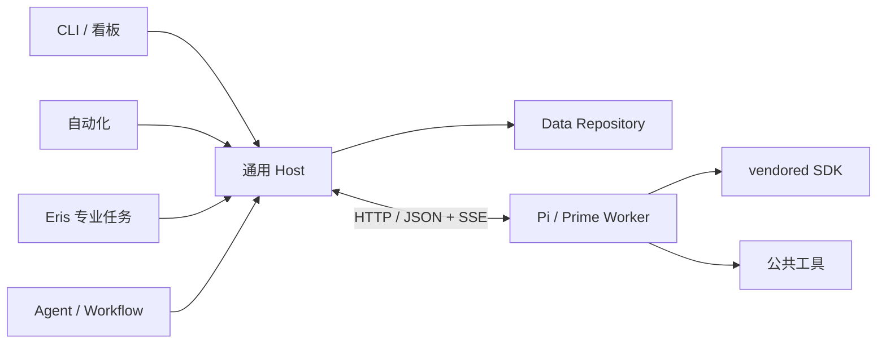

# 架构与扩展

[返回首页](../README.md) · [模块地图](modules/README.md) · [开发与验证](development.md)

## 模块

应用 Host 组装 Agent、Workflow、存储与底座；通用 Host 只调度注入的定义。

依赖及公开入口见模块地图。Agent 互不导入；Workflow 连接业务阶段；Data 管文件、锁与日志；Runtime 管进程、传输和 SDK；Contracts 保持纯类型与规则。

## 生命周期

一个 run 由一个持锁 Host 写入；一个 Worker 同时执行一个 attempt。任务按依赖就绪后调度，优先补运行数较少的阶段，同额时优先计划中靠后的阶段，不抢占运行任务。

任务与提交使用持久化 UUID。只有当前 attempt 可提交，同 UUID 重发内容必须一致。提交、取消和替换串行化；先保存待落盘收据，再刷盘正式结果，最后保存引用状态并确认。崩溃恢复保留已接受结果，冲突或缺行明确报错。

Worker 清理会话和工作区后报告终态；Host 收齐记录和所需产物再释放副本。失联先查收据，再按剩余预算决定重试。托管 Worker 由 Host 替换，外部 Worker 由调用方恢复。续跑与预算见[使用指南](usage.md#运行与恢复)。

锁只支持可信单机协调：完整写入 PID/token 后排他发布，确认进程不存在才回收。损坏 owner 或回收标记报错，不猜测接管。实现见 [files.ts](../packages/data/src/files.ts)。

## HTTP 协议

内部路由统一 `/api`，无协议版本和远程鉴权。启动核对底座身份、构建 UUID 与工具能力；模型凭据仅传环境变量名。畸形 URL、JSON 和处理异常由 HTTP 边界返回错误。

| 服务 | 路由与用途 |
|---|---|
| Worker | `GET /api/health`；`POST /api/attempts` 创建 attempt |
| Worker | `/api/attempts/:id` 查询、删除；子路由 `cancel`、`events`、`artifacts/:id`、`record` |
| Host | `/api/inputs/:id` 读取所属活跃材料 |
| Host | `/api/evidence-bank`、`/api/inspections`、`/api/submissions` 保存目录、首查与提交 |
| Host | `GET /api/submissions/:id` 查收据；`/api/tasks/:id/checkpoint` 保存草稿与计数 |
| Host | `/api/control/concurrency`、`/api/control/stop` 以锁 token 控制；`/api/progress` 只读进度 |

精确方法与参数见 [Host](../packages/host/src/runner.ts)、[Worker](../packages/runtime/src/server.ts)。SSE 按 attempt 连续 seq，支持 after 与 Last-Event-ID；Host 去重、查缺并续读。短暂查询失败不代表 attempt 失联；外部 Worker 忙碌不消耗评测尝试。

Adapter 展开本地静态 Schema 引用，拒绝外部、循环和动态引用。提交正文由 Host 校验；普通工具仍做 SDK 参数校验。提交协议见[数据契约](contract.md#提交方式与反馈)。

显式提示词缓存仅在渠道声明 `supports_explicit_prompt_caching=true` 时启用，适用于支持的 GPT Responses 评测请求；其他请求保留 SDK 策略。它不复用判词或跨任务会话，实际收益以服务返回用量核对。实现与测试见 [sdk-utils.ts](../packages/runtime/src/sdk-utils.ts)。

本机看板的 `/api/dashboard` 复用 CLI 预检与独立运行子进程，控制转发到持锁 Host，页面不调度或写结果。只读监控投影不替代权威文件。

## 接口和底座路由

| 接口 | 职责 |
|---|---|
| AgentDefinition / AgentProfile | 提示词、工具、请求/提交/结果 Schema 与业务校验 |
| WorkflowDefinition | 规划、绑定、恢复、动态后续任务与依赖 |
| RunRepository / RunCodec | Data 执行 IO，Workflow 提供纯编解码 |
| InputSource / SourceReader | 描述并解析来源 |
| AgentBackend | SDK 会话、事件、取消和释放 |

类型见 [Contracts](../packages/contracts/src/index.ts)，组装见 [composition.ts](../apps/host/src/composition.ts)。Runtime 客户端不加载 SDK。CLI 选择统一底座；库调用可用 `engineForTask` 路由到混合 Worker 池。

`request` 是校验依据，`modelInput` 只用于展示。盲测、改写槽位、核验和聚类分片均由 Workflow 管理，具体语义见[数据契约](contract.md)。

## 新工具

1. 在 Tools 实现 ExecutableTool，处理取消、参数和结果。
2. 在 Prompts 添加工具描述，将工具加入 Profile 的 toolNames。
3. 通过 createRegistry 注册；两种 Adapter 转换为 SDK 工具，不修改调度器。

探索、必读页、保留写稿与内容提交分别计数。重复读取、参数错误及缓存命中仍计探索调用；实际新增必读页不挤占探索额度。细节只由 [RequiredReadBudget](../packages/tools/src/required-reading.ts)、[工具注册器](../packages/tools/src/index.ts)和模型反馈维护。

读取结果只在单 attempt 复用；代码执行不缓存、不注入模型凭据，取消和退出回收所属进程组。工作目录不是操作系统沙箱，主动脱离进程组的代码不在清理保证内。

## 底座源码开发

两套 vendor 使用独立依赖树。Pi 只注册应用网关模型；Prime 应用构建不下载模型目录。构建记录保存于 `.runtime/pi.json`、`.runtime/prime.json`，修改后按[开发指南](development.md#构建与依赖)重建。

## 独立分析助手

[Eris](../agent/README.md) 通过 Contracts 的数据源、专业网关与 Session 接口访问能力，应用 Host 注入实现。专业网关复用 Host 的校验、提交和恢复。

Runtime 转换 Pi 与 Deepseek 会话事件，Data 维护权威追加记录及单个持锁执行者，其他本机副本转发。原始材料按引用重读，不复制进会话。
