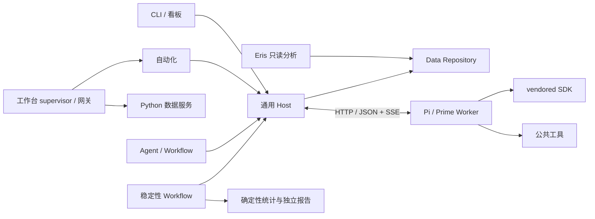

# 架构与扩展

[返回首页](../README.md) · [模块地图](modules/README.md) · [开发与验证](development.md)

## 模块

应用 Host 组装 Agent、Workflow、存储与底座；通用 Host 只调度注入的定义。

依赖及公开入口见模块地图。Agent 互不导入；Workflow 连接业务阶段；Data 管文件、锁与日志；Runtime 管进程、传输和 SDK；Contracts 保持纯类型与规则。

Comparison 与 Answer-review 分别拥有配置、任务规划和续跑；共用输入编目、来源读取与评审材料由 Workflow 的 Inputs、Review 模块提供。共享模块不导入具体工作流，独立评测不调用对战规划器。

## 生命周期

一个 run 由一个持锁 Host 写入；一个 Worker 同时执行一个 attempt。任务按依赖就绪后调度，优先补运行数较少的阶段，同额时优先计划中靠后的阶段，不抢占运行任务。执行范围建立集合索引，范围替换或追加后更新，避免每轮调度逐任务扫描整个范围。任务名额已满时不重复扫描全量计划来扩充 Worker；空位释放或配额提高后继续补位。Worker 等待 Host 核查或最终提交确认时暂停模型空闲计时，总任务截止时间仍然有效，避免将正常排队提交误判为空闲。

任务与提交使用持久化 UUID。只有当前 attempt 可提交，同 UUID 重发内容必须一致；提交、取消和替换按任务串行化，不同任务不再共享全局提交锁。每个 run 在本地盘维护一个 SQLite WAL 热日志，收据、任务终态、后继任务、submission 唯一约束和 outbox 事件在同一短事务中提交；事务返回后 Host 才确认成功，不等待 Ceph 或完整检查点。进程重启重放热日志，正式结果和进度事件由单 outbox worker 分批投影到 Ceph。整机故障最多丢失尚未投影的 5 秒已确认进度。

outbox 先写正式 JSONL，再写 `progress.jsonl`，最后标记事件已投影。已存在且逐字段相同的结果行按业务 ID 跳过，同 ID 不同正文明确报错。`state.json` 是按事件序号周期生成的派生摘要，只保留最近三条错误的结构化诊断，不保存 draft、completion candidate、inspection、evidence bank 或完整 review 审计；完整修复上下文只在本地热日志和进度事件中。JSONL 逐块扫描换行，只在整行齐备时拼接；压缩、UTF-8、中断尾行和不可变行坐标规则保持一致。恢复和周期快照只复制可变收据包装，共享不可变的已接受正文。

outbox 自身积压不阻塞在途提交；最早事件超过 5 分钟或待投影数据超过 10 GB 时暂停新 attempt，已运行任务仍可完成和提交。短时 Ceph 故障由 outbox 退避重试，不回滚已确认收据，也不静默丢弃事件。

可选的运行级 `maxAttempts / stopStartingAt` 由通用 Host 执行，不了解业务实验。最终 admission 检查与单调累计计数递增之间没有异步间隙，先持久化再发起 Worker；Workflow 撤下任务不退还已消耗次数。截止只阻止新派发，不丢弃在途结果。

Worker 清理会话和工作区后报告终态；Host 收齐记录和所需产物再释放副本。终态采集期间仍可能接受提交，Host 将结束尝试与接受提交串行化后重查持久化收据；成功收据优先于先前的失败观察，不计入熔断或重新派发。没有成功收据时按剩余预算决定重试。托管 Worker 由 Host 替换，外部 Worker 由调用方恢复。续跑与预算见[使用指南](usage.md#运行与恢复)。

锁只支持可信单机协调：完整写入 PID/token 后排他发布，确认进程不存在才回收。损坏 owner 或回收标记报错，不猜测接管。实现见 [files.ts](../packages/data/src/files.ts)。

## HTTP 协议

Worker 与 Host 内部路由统一 `/api`，无协议版本。启动核对底座身份、构建 UUID 与工具能力；模型凭据仅传环境变量名。畸形 URL、JSON 和处理异常由 HTTP 边界返回错误。

| 服务 | 路由与用途 |
|---|---|
| Worker | `GET /api/health`；`POST /api/attempts` 创建 attempt |
| Worker | `/api/attempts/:id` 查询、删除；子路由 `cancel`、`events`、`artifacts/:id`、`record` |
| Host | `/api/inputs/:id` 读取所属活跃材料 |
| Host | `/api/evidence-bank`、`/api/inspections`、`/api/submissions` 保存目录、首查与提交 |
| Host | `GET /api/submissions/:id` 查收据；`/api/tasks/:id/checkpoint` 保存草稿与计数 |
| Host | `/api/control/concurrency`、`/api/control/stop` 以锁 token 控制；`/api/progress` 只读进度 |

精确方法与参数见 [Host](../packages/host/src/runner.ts)、[Worker](../packages/runtime/src/server.ts)。SSE 按 attempt 连续 seq，支持 after 与 Last-Event-ID；Host 去重、查缺并续读。短暂查询失败不代表 attempt 失联；外部 Worker 忙碌不消耗评测尝试。首次派发遇到连接重置或超时、且 Worker 明确返回该 attempt 不存在时，Host 使用相同 attempt ID 和内容最多重发两次；不会新建模型尝试或重置内容额度。

Adapter 展开本地静态 Schema 引用，拒绝外部、循环和动态引用。提交正文由 Host 校验；普通工具仍做 SDK 参数校验。提交协议见[数据契约](contract.md#提交方式与反馈)。

显式提示词缓存仅在渠道声明 `supports_explicit_prompt_caching=true` 时启用，适用于支持的 GPT Responses 评测请求；其他请求保留 SDK 策略。它不复用判词或跨任务会话，实际收益以服务返回用量核对。实现与测试见 [sdk-utils.ts](../packages/runtime/src/sdk-utils.ts)。

工作台网关监听内部 `5001`，为 `0.0.0.0` 上唯一对外服务；数据服务 `8081`、自动化看板 `4174` 和运行实例看板 `4173` 只监听回环地址。生产只提供 `/` 单页，页面片段和静态资源通过 `/workbench-assets/` 加载；网关按[路由白名单](../apps/host/src/workbench-routes.ts)转发 `/data/` 数据接口与 `/runtime/api/` 接口。

工作台在网关层完成单管理员登录、会话 Cookie 与 relay Bearer token 校验；页面和 API 不自建账号体系。运行实例页的 `/runtime/api/dashboard` 复用 CLI 预检与独立运行子进程，控制转发到持锁 Host，页面不调度或写结果。只读监控投影不替代权威文件。

## 接口和底座路由

| 接口 | 职责 |
|---|---|
| AgentDefinition / AgentProfile | 提示词、工具、请求/提交/结果 Schema 与业务校验 |
| WorkflowDefinition | 规划、绑定、恢复、动态后续任务与依赖 |
| RunRepository / RunCodec | Data 执行 IO，Workflow 提供纯编解码 |
| InputSource / SourceReader | 描述并解析来源 |
| AgentBackend | SDK 会话、事件、取消和释放 |

类型见 [Contracts](../packages/contracts/src/index.ts)，组装见 [composition.ts](../apps/host/src/composition.ts)。Runtime 客户端不加载 SDK。CLI 选择统一底座；库调用可用 `engineForTask` 路由到混合 Worker 池。

`request` 是校验依据，`modelInput` 只用于展示。盲测、改写槽位、核验和聚类分片均由 Workflow 管理，具体语义见[数据契约](contract.md)。

前置任务材料直接展示原问、参考事实与回答，不重复展示 Criteria 生成的目标和要求摘要。完整 `task_analysis` 及规范原文仍保留在正式请求中，避免出现另一份被改强或改弱的交付要求。独立视觉采集占位块在材料投影中标为 `capture_gaps`；它描述采集状态，不推断用户界面的实际渲染，也不改写原始来源或证据坐标。

稳定性实验复用 Agent 与 Backend，单独规划基准、原位、换位、改写和整链试次。实验 codec 只把来源坐标、依赖和收据引用保存到恢复状态；Data 仍负责文件与锁，统计使用确定性 TypeScript 函数。来源 run 只读，实验结果使用独立 JSONL，不经过生产胜负导出和上传。该边界借鉴[独立评估器](https://deepeval.com/docs/metrics-custom)和[可替换模型接口](https://github.com/langchain-ai/openevals/blob/main/README.md)，没有引入新的评测框架。

## 新工具

1. 在 Tools 实现 ExecutableTool，处理取消、参数和结果。
2. 在 Prompts 添加工具描述，将工具加入 Profile 的 toolNames。
3. 通过 createRegistry 注册；两种 Adapter 转换为 SDK 工具，不修改调度器。

探索、必读页、保留写稿与内容提交分别计数。重复读取、参数错误及缓存命中仍计探索调用；实际新增必读页不挤占探索额度。Host 的初始、动态必读登记和读取审计均使用本次任务绑定后的可信来源，与 Worker 实际读取的消息坐标一致，不直接读取适配前的持久输入结构。细节只由 [RequiredReadBudget](../packages/tools/src/required-reading.ts)、[工具注册器](../packages/tools/src/index.ts)和模型反馈维护。

读取结果只在单 attempt 复用；代码执行不缓存、不注入模型凭据，取消和退出回收所属进程组。工作目录不是操作系统沙箱，主动脱离进程组的代码不在清理保证内。

## 底座源码开发

两套 vendor 使用独立依赖树。Pi 只注册应用网关模型；Prime 应用构建不下载模型目录。构建记录保存于 `.runtime/pi.json`、`.runtime/prime.json`，修改后按[开发指南](development.md#构建与依赖)重建。

## 独立分析助手

[Eris](../agent/README.md) 通过 Contracts 的只读数据源与 Session 接口访问能力，应用 Host 注入 Comparison / Answer-review 读取和账户认证，不创建评测。

Runtime 转换 Pi 与 Deepseek 会话事件，Data 维护权威追加记录及单个持锁执行者，其他服务器进程通过认证转发。原始材料按引用重读，不复制进会话。
