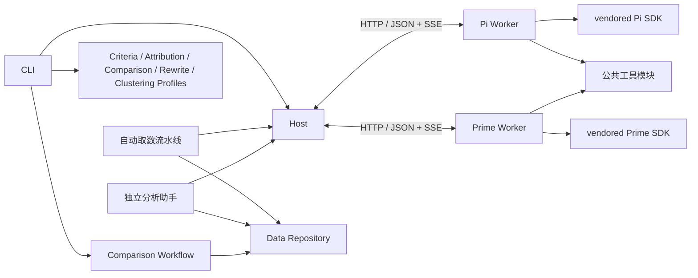

# 架构与扩展

[返回首页](../README.md) · 安装和操作见[使用指南](usage.md)。

先看模块表和[模块地图](modules/README.md)定位代码；只有扩展协议、工具或 vendor 时再阅读后面的对应章节。通用开发约束见[开发指南](development.md)。

## 模块



| 位置 | 职责 |
|---|---|
| `apps/host`、`apps/worker` | CLI、本机看板、分析助手入口、配置、具体 Agent / Workflow / 底座组装 |
| `agent` | 独立 Web 对话、分析工具及 Deepseek 客户端装配；能力通过 Contracts 注入 |
| `packages/contracts` | 通用 JSON、Agent / Workflow / Repository 接口、跨进程协议 |
| `packages/host` | 编排、调度、提交有效性、重试、恢复、进度 |
| `packages/automations` | 持续发现输入、下载/评测/四小时交付队列、日期级恢复与退避；通过应用注入取数、存储、评测和上传 |
| `packages/runtime` | 进程客户端、HTTP/SSE、Mongo 增量写入、线上日志上传、会话和工作区、Pi / Prime Adapter |
| `packages/agents/src/criteria` | 只按问题、标准答案及候选约束制定共同验收基准，不读取回答 |
| `packages/agents/src/comparison` | 对比 Profile、业务校验；使用集中提示词与根目录 `schemas/comparison` |
| `packages/agents/src/rewrite` | 改写 Profile、槽位校验；只润色文本，不接触证据；使用集中提示词与根目录 `schemas/rewrite` |
| `packages/agents/src/attribution` | 归因 Profile、业务校验；只描述问题，不维护问题库；使用集中提示词与根目录 `schemas/attribution` |
| `packages/agents/src/clustering` | 聚类 Profile、纯问题库归类/合并与数量上限校验；文件读写和锁属于 Data；使用集中提示词与根目录 `schemas/clustering` |
| `packages/workflows/src/comparison` | 适配器注册表、评测集元信息抽取、配置化分组对比、盲测、依赖与材料映射、改写组合、状态编解码、报告 |
| `packages/data` | 本地源读取与输入索引存储、原子状态保存、结果及会话记录追加、锁 |
| `packages/tools` | 材料、检索、图片、计算、代码执行和产物；执行逻辑不保存模型可见描述 |
| `packages/prompts` | 集中维护五阶段评测规则、总分析助手提示词、任务材料/预算/恢复文案及工具描述；专家示例尚未启用 |
| `schemas` | 集中维护五阶段、Workflow 导出及分析助手工具输入的 JSON Schema |
| `vendor/pi`、`vendor/prime-agent` | 可直接开发的固定源码和锁文件 |
| `vendor/deepseek` | 分析助手移植的 Deepseek 客户端、传输及会话投影源码；来源与局部修改见 [Agent 说明](../agent/README.md#模块与上游) |

公开入口、依赖和验证入口见[模块地图](modules/README.md)。跨包代码依赖只使用 `@eval/*` 公开导出；根目录 `schemas/` 是集中管理的 JSON 资源模块，由构建步骤复制到运行目录。Host 不识别候选或判决，Data 不包含评测规则，Runtime 不负责跨任务调度，Contracts 不包含文件、网络或 SDK 实现。Agent 之间禁止互相导入；Workflow 将前置结果映射为下一 Agent 的输入。

Comparison Workflow 默认将每个候选对规划为一个 `default` 任务，依赖共同 Criteria 与双方已接受 Attribution。接受后直接写正式 `comparison.jsonl`；改写和交付引用该节点。归因、对比文案默认自动改写，可显式关闭。聚类默认不进入主线，后置执行后默认改写；主线不安排独立核验或自动归因复核。

显式 `verify-comparisons` 为已接受正式对比准备独立 `verification` 任务，使用新的 UUID 和只含核验的执行范围；结果写 `comparison-verification.jsonl`。核验请求保留完整可信材料，首查隐藏上游归因及排名，成功后再揭示。Registry/Host 持久化检查点，Worker 的首查与最终提交共用内容预算；恢复重新验证可信检查点。核验仅记录确认或疑点，不替换正式结果，不触发归因重做或修改下游依赖。协议见[数据契约](contract.md)。

证据选号目录属于 task 的程序恢复状态：Contracts 提供纯坐标与选号 helper，Workflow 只投影自己生成的材料引用并排除原始 source values，Tools 只登记实际返回的完整页，Worker 在返回前保存目录，Host 独立校验追加前缀和本次实际绑定来源。首查按模型选号解析后保存 canonical checkpoint；恢复使用 canonical Schema，后续模型 Schema 或模型参数变化不会重新编号已成功首查。

独立 Attribution 调用可读取程序登记的同批次、同 case、同原问参考材料作为 `grader_only` 事实源；每个来源保留各自原用户时间，缺失保持未知，不用对方时间或私有指令补本方依据。外来正式证据保留 `source` 与 `source_input_id`，报告与看板按真实输入 ID 定位，不能套用本方消息索引。

## 生命周期

Host 是单一写入者。每个任务可有多个 attempt，只有当前有效 attempt 能提交。提交 ID 为 UUID，同次提交重发沿用原 ID；相同 ID 内容冲突时拒绝。提交、取消和替换 attempt 串行化，过期 attempt 不能覆盖当前任务。收据和对比结果按[持久化顺序](usage.md#运行产物)落盘后才确认；提交确认只依赖结构、引用和持久化顺序。

`.run-lock` 排除第二个 Host：完整 owner 先写入临时文件，再排他原子发布，竞争者不会读到初始化中的空文件。探测或回收前校验 owner 的正整数 PID 与非空 token；进程不存在时回收陈旧锁。已存在的锁文件内容不完整，或目录中遗留 `.run-lock.reclaim`（即使 `.run-lock` 已不存在），则拒绝继续，确认原进程停止后再清理。会话 owner 探测复用同一锁校验。共用日志锁对活跃持有者与获取竞态作有界等待；尚未写完的锁 JSON 只给一秒初始化缓冲，PID/token 无效或遗留恢复标记则立即拒绝。锁不提供跨机高可用。

每个 Worker 同时运行一个 attempt，独立会话、配置目录、材料副本、代码目录和日志；会话与临时工作目录清理完成后才对外报告最终状态。默认 Host 只保留 `state.json` 中的收据、状态和用量，已接受收据同时固化产出它的 `evaluatorVersion` 和解析后的判官模型 ID，不保存模型连接配置；托管 Worker 使用系统临时目录并在结束时清除。开启 debug 后，参数、状态、用量、失败原因及未接受提交合并到 `_internal/` 的 `attempt.json`，事件单独压缩；记录与工具产物收齐后才释放 Worker 副本。失联先查收据，无收据才可重试。Host 仅在当前活跃 attempt 保留执行 spec；结束、替换或成功提交后释放其提示词及恢复材料，提交重发仍按持久化收据校验。Host 管理的失效 Worker 会被替换，外部失效 Worker 需调用方重启后恢复。

## HTTP 协议

Worker 状态查询超时或连接临时重置只表示本次观察未完成，Host 继续查询同一个 attempt，不据此取消会话或重做评测；显式中断和任务总时限仍生效。连接被拒绝等真实失联按收据检查与恢复流程处理。

失败续跑保留具体错误和仍可修复的未接受草稿，每个新 attempt 重新计算连续重复错误次数；因独立文件加载限制而停止时，旧草稿仅留在检查点，不进入新提示或新工作目录。完整错误集与 JSON 内容均相同的重复提交保留诊断计数，并明确反馈未修改字段；错误顺序与对象键顺序不计。重复内容不提前扣除剩余修正机会，所有内容提交共用首次加 repairAttempts 次修正的累计上限；达到上限后停止，不重置累计提交次数，不重复执行已接受任务。上游流在缺少结束标记时断开按传输故障处理；无可续修业务草稿的零提交提前结束和空闲超时保留执行中断分类。可恢复故障的重试预算见[运行与恢复](usage.md#运行与恢复)。

Responses 工具调用在响应终态确认参数：按 `output_item.added`、`output_item.done` 与终态输出核对调用身份，拒绝重复或不一致的调用 ID，并处理参数增量晚于 `output_item.done` 到达的流；最终参数必须是完整 JSON 对象，不把临时空参数作为完成结果执行，也不通过猜测或类型转换修复不合法 JSON。HTTP/API 返回的 5xx（包括集群过载 529）作为传输故障进入有界重试，不能将业务文本中的普通数字误判为状态码。

Workflow.bind 必传当前任务清单，Host、复核与离线校验按共同 Criteria 的任务恢复同一去身份映射；上下文只供程序使用，不进入提示词或重复落盘候选资料。公共工具提取实际回答链指令并生成真实文本证据；Workflow 组装 instruction_sources、criterion_instruction_sources 与 citation_inventory，并统一去身份及模型可见投影。Attribution 只验证规范与交付闭环，Comparison 校验当前候选对共同作用域；注脚来源目录也供 Workflow 回溯标注复用，避免两套编号解析。证据原文和坐标不受语义核对的标记遮蔽影响。

评测 Adapter 向模型注册工具时展开 JSON Schema 的本地静态 JSON Pointer 引用，保持约束语义；外部、循环、动态引用或嵌套资源标识明确报错，不进行网络解析。提交工具在模型请求中保留完整 Schema，SDK 只检查完整 JSON 对象并将字段原样交给 Host，避免本地业务 Schema 拒绝或类型转换遮蔽集中反馈；普通工具继续执行 SDK 参数校验。完整 JSON 提交统一由 Host 使用原始 Schema 校验，不转换模型返回值，也不放宽字段类型；Worker 保留文件参数与读取校验。

外部 Worker 启动时繁忙或派发前健康检查失败时，任务保留待执行状态，不消耗一次评测尝试；该 Worker 暂停接收任务并定期检查，恢复空闲且构建身份匹配后重新纳入调度。所有可用容量长期未恢复时，Host 中断并保留待执行任务供续跑，不把整批题目逐个判失败。失败依赖在一次调度循环中批量保存，避免逐条写入整份检查点阻塞新就绪的对比或改写。

上游仍在执行有界重试（含退避等待）时，其下游继续等待；只有上游本轮执行真正结束且未成功，才将依赖任务标记为阻塞，避免上游恢复后留下永久阻塞的对比或改写。

内部路由使用 `/api` 命名空间，不设置协议版本号。Host 和 Worker 同步构建部署，启动时校验底座身份、构建 UUID 和工具能力。畸形 URL 和无效 JSON 返回 HTTP 400；路由处理器同步抛错与异步拒绝进入同一错误响应边界，不退出服务进程。

请求用任务、输入和产物 ID，不传 Host 本机路径。输入与任务按业务标识首次登记持久化 UUID，产物使用 UUID。模型配置传递 `apiKeyEnv` 而非密钥值，实际密钥从环境注入。当前只支持可信单机调用，未配置远程认证，不应直接暴露公网。

| 接口 | 行为 |
|---|---|
| Worker `GET /api/health` | 引擎身份与构建 UUID、工具、活动 attempt |
| Worker `POST /api/attempts` | 校验能力并创建会话 |
| Worker `GET /api/attempts/:id` | 查询状态 |
| Worker `POST /api/attempts/:id/cancel` | 中断所属会话与进程 |
| Worker `GET /api/attempts/:id/events?after=N` | SSE 续读，也支持 Last-Event-ID |
| Worker `GET /api/attempts/:id/artifacts/:id` | 产物字节 |
| Worker `GET /api/attempts/:id/record` | 已结束尝试的完整记录，包括最终用量、工具审计及未接受提交 |
| Worker `DELETE /api/attempts/:id` | Host 归档后释放已结束 attempt 的副本 |
| Host `GET /api/inputs/:id?attempt=<attempt-id>` | 所属活跃 attempt 的材料视图 |
| Host `POST /api/submissions` | 校验、原子提交 |
| Host `GET /api/submissions/:id` | 确认已保存收据 |
| Host `POST /api/tasks/:id/checkpoint` | 持久化最后草稿、结构化错误和修复计数 |
| Host `POST /api/control/concurrency` | 使用本机运行锁 token 调整目标并发并唤醒调度器 |
| Host `POST /api/control/stop` | 使用本机运行锁 token 请求停止当前运行 |
| Host `GET /api/progress` | 当前进度、失败分类、吞吐和 ETA 区间 |

事件包含 `seq/attemptId/time/type/data`，在单个 attempt 内连续编号。Host 检测缺口、去重并续读；模型结束事件不代表提交成功。流式更新仅记录增量，完整消息保存在 `message_end`；开始、回合结束和会话结束事件不重复保存消息正文。

应用 Host 的本机看板使用独立的 `/api/dashboard` 路由：应用层校验本次运行的可编辑字段（含评测模型范围）并复用 CLI 配置解析与 Workflow 预检；看板的新运行预检/启动只生成概要计划（不装载原始输入），日期盘点与预检通过 Workflow 的 `createInputScanCache` 共用按文件修订及适配配置校验的轻量投影；选择或预算变化只重建任务计划，来源变化只重读受影响文件。索引限定用于新运行只读预检，不用于执行或续跑；真正的 run 计划由 CLI 子进程构建；Workflow 的只读投影扫描已登记来源，生成可勾选的日期与可抽样样本，按业务标识列结果样本、重定位原始记录并只取问题与最终回答（不加载消息链路）；case 详情只含任务概要，任务结果在展开时通过 Repository 按任务读取正式 JSONL 行（不加载整个 run 的结果文件）。浏览器入口负责状态、请求和事件编排，`dashboard-view.js` 通过 `createDashboardViews` 接收最小 DOM/状态依赖，集中负责输入、任务结果和结构化结果渲染。看板不承担任务调度或结果写入，控制命令仍转发到拥有运行锁的 Host；使用方式见[本机运行看板](usage.md#本机运行看板)。

## 接口和底座路由

[通用契约](../packages/contracts/src/index.ts)区分以下接口：

- `AgentDefinition` 登记能力；`AgentProfile` 配套定义提示词、请求 Schema、本地提交 Schema、接受结果 Schema、引用展开及业务校验；可选 `modelSubmissionSchema(request)` 按可信请求生成模型参数 Schema，不使用展示投影，也不改变本地校验。可选 `validateSubmission` 安全检查部分或结构无效的草稿，独立业务错误与结构错误合并反馈；Attribution 的可识别引用坐标同样提前检查，不等待其他结构或覆盖错误修完。全部通过才校验正式结果。Worker 收到的 `EvaluationSpec.outputSchema` 用于向模型描述提交参数。
- `WorkflowDefinition` 规划任务和依赖，恢复输入，将原始记录与前置收据映射为 `AgentBinding`；可选同步 `advance` 规划已验证收据的后续任务，Host 串行提交收据、任务变更和结果，持久化失败时回滚此次任务变更。`blockedReason` 在依赖已接受后检查下游是否仍需等待；可选核验没有指向正式对比改写或聚类的下游依赖。
- `RunRepository` 读写状态，为每个 run 创建结果写入器。Data 接收 Workflow 的纯 `RunCodec` 与结果转换函数，负责当前状态结构和 JSONL 转换；`OutputTarget` 指定目标，`RunLayout` 是 run 目录结构的唯一 owner。
- `InputSource` / `SourceReader` 描述一个版本的来源（单文件或递归目录）并在 Data 中解析，Workflow 只处理解析后的记录。
- `AgentBackend` 适配 SDK 会话。Runtime 的客户端公开入口不加载 SDK，Worker 应用按选择加载 Adapter。

[应用组装](../apps/host/src/composition.ts)将以上定义注入 `runEvaluation`。替换 Profile 时一起更新[集中提示词](../packages/prompts/README.md)、请求/提交/接受结果 Schema 和校验；Host 在依赖收据就绪后绑定任务输入、校验请求 Schema 并选择具备所需工具的 Worker，提交时再检查提交和解析后的结果。Host 将每个 attempt 的完整提示词及所选工具描述交给 Worker，两种 SDK Adapter 只接收组装好的文本；Tools 和 Runtime 不导入评测提示词模块。Schema 文件集中在根目录的 [`schemas/`](../schemas/README.md) 模块；当前通过 TypeScript 对象组合任务，不引入新编排语言。

Repository 的完整读取与按任务读取复用同一流式 JSONL 路径，不先将整个结果文件读入字符串；完整读取检查文件内全部重复 ID，局部读取只保留选中结果，两者都检查冲突与缺行并忽略未完成末行。

源记录、任务、attempt、收据和正式结果分别管理：原始数据只在源文件，评测集目录只保存显式来源和逐行字节坐标（不保存消息正文），任务登记输入引用，attempt 使用临时材料，未接受草稿进入状态，正式结果写入 JSONL，状态仅保留恢复索引。证据按 `batch_id + case_id + version` 的业务标识定位，不依赖文件位置。问题库是每个模型一份的跨 run 知识库：按组件/问题类归类、出现样本可追溯；样本身份仍是本方 input UUID 与 finding ID，代表证据只选本方真实证据，缺少时明确报错；跨来源证据完整保留在归因结果中，不把对方消息坐标记录成本方位置；合并会更新类状态与样本归属，同时追加血缘事件，按模型锁住读改写（参见[使用指南](usage.md#目录约定)）。

归因位于 `packages/agents/src/attribution`，只输出每条回答的归因结果与 `problem.component/label/definition`，不读问题库、不建类。聚类位于 `packages/agents/src/clustering`；`cluster --run` 在该 run 的全部归因任务结束后，按 `(模型 × 批次)` 从已接受归因准备分片，失败归因不参与。先归入已有类，确实没有才在预算内新建，必要时合并近义类；问题库由 `data/problems/<version>.json` 持久化。聚类不等待对比或可选核验，组合和报告属于 Workflow。

改写已实现于 `packages/agents/src/rewrite`：它只接收 Workflow 选定的文本槽位，输出同 id 的润色文本；正式结果 JSONL 保留裁判原文，改写附在源结果的 `rewritten` 字段，报告与逐题总结优先展示改写文案。

一个 Host 管理一个 run，多个 Worker 并行执行；多个 Host 使用不同 run 目录。每个 attempt 独立会话、工具上下文与工作区，取消只作用于所属任务；默认端口由系统分配。应用传入 Worker 入口、仓库路径和 Python 配置，没有全局共享会话。

调度按每个任务的依赖就绪情况推进，基准、归因、对比、改写可同时运行，不等待整批上一阶段结束。空闲槽位优先补给运行中任务较少的就绪阶段，同额时优先计划中靠后的阶段；没有就绪任务的阶段不占用配额。总并发上限仍由 Host 控制，运行中的任务不抢占，失败依赖只阻塞所属后续任务。

[失败熔断](../packages/host/src/failure-guard.ts)只消费通用阶段与 ValidationIssue 签名，不识别评测业务。它按不同任务维护有界窗口，将暂停原因写进 manifest；调度和 attempt 重试都检查该状态，健康阶段继续，显式恢复才清除暂停。初始托管 Worker 只按实际就绪任务启动，避免在所有剩余任务被依赖或熔断阻塞时空建进程。

[定向修复](../packages/workflows/src/comparison/repair.ts)属于 Workflow：在运行锁内计算依赖范围及文本槽位，预览与应用共用选择逻辑；应用只改变选中进度并保存通用 `executionScope`，不另存输入或正式正文。聚类分片只有其余依赖均已接受或已选中时才自动随局部补跑推进，不能反向拉入整批未完成样本。Host 只按 UUID 范围调度；Workflow 在固定范围下跳过输入发现，并只加载所需记录。分层试跑、交付覆盖和文案审阅在[交付模块](../packages/workflows/src/comparison/delivery.ts)，不进入通用调度器。

`AttemptSpec` 包含任务标识、引擎版本与构建 UUID、模型、输入引用、预算、截止时间和评测契约。Host 不依赖上游 SDK 类型；底座公共接口只覆盖创建、运行、事件、取消和释放。

```ts
await runEvaluation({
  ...options,
  engine: 'pi',
  engineForTask: task => task.stage === 'attribution' ? 'pi' : 'prime',
  workerUrls: ['http://127.0.0.1:4101', 'http://127.0.0.1:4102'],
});
```

同 run ID 沿用持久化任务 ID 及 A/B 分配，始终保留已接受收据，未完成任务按当前路由和参数继续；输入与选择范围的处理见[运行与恢复](usage.md#运行与恢复)。CLI 选择统一底座，Host 库支持混合池；实际并发受当前目标并发限制。

## 新工具

```ts
const extraTool: ExecutableTool = {
  name: 'count_inputs',
  inputSchema: {type:'object', properties:{}, additionalProperties:false},
  async execute(context, _arguments, signal) {
    signal.throwIfAborted();
    return {content:[{type:'text',text:String(context.inputs.size)}]};
  },
};
await startWorker(backend, workerDirectory, createRegistry([extraTool]));
```

将工具名加入 Profile 的 `toolNames`，同时在 Profile 的 `toolDescriptions` 中提供非空描述；缺失会拒绝创建 attempt。内置评测工具的描述只编辑[提示词模块](../packages/prompts/README.md)的 `resources/tools/<工具名>.md` 并登记在其工具清单，不在 Tools/Runtime 中写第二份。两种 Adapter 自动转换为原生 SDK 工具，无须修改调度代码。当前通过 `createRegistry` 按代码注册执行逻辑。

工具审计 calls 记录总调用数，requiredReadCalls 记录成功返回新必读正文页的调用数；除成功必读页和独立保留的写稿调用外，其他调用消耗探索预算，参数错误、重复读取与缓存命中仍占探索额度。fileWriter 是注册工具能力；需要文件的首次内容轮次、内容拒绝后的修正及成功首查后的最终稿各保留一次写稿调用，不累积且总使用次数不超过 1 + repairAttempts，文件加载拒绝未达三次时，若内容与写稿总次数仍有余额，重新提供一次修正写稿调用；已用次数不返还。探索耗尽后消费保留额度，执行与参数错误均计数。预算分别显示探索、必读与写稿余额，audit.calls 仍记录真实总调用数。Profile 声明通用 requiredReads 坐标，Host 与 Worker 共用 Contracts 的纯函数，根据原文实际转义长度与完整页元数据计算有限必读额度，Host 同时核对新读区间确实推进声明材料；按首个缺口连续读取、省略 `max_chars` 或使用 `max_chars=16000` 的新页不挤占探索额度。提交有独立修正预算。材料工具提供分页、定位和用于模型提交的 `reference.evidence_index`；完整 `evidence_id` 由程序保留并贯穿正式结果；原文与产物页都在完整 JSON 输出预算内分页，目录 source_offset 独立于正文 offset。工具结果附带实时探索/必读剩余额度，缓存只复用数据。`read_trace`、`search_trace`、`read_artifact` 在单个 attempt 内复用相同参数的读取结果，重复调用仍计入预算。代码返回摘要，完整 stdout/stderr、脚本和 `outputs` 声明的文件存为可分页读取的产物；代码执行不缓存。非零退出、超时、取消和声明产物读取失败均标记为工具错误；反馈保留实际 exit_code、stdout、stderr，产物读取错误以 code_output_invalid 和 outputs 索引单列，不能以后续文件缺失覆盖脚本失败原因。十进制计算的加减乘和有限除法精确；循环小数最终商按 34 位有效数字半偶舍入，结果标明精度。

代码进程不注入模型凭证。生命周期监护进程在 IPC 断开、取消或超时后回收所属进程组。工作目录不是安全沙箱，主动脱离进程组的代码不属于此清理保证。

## 底座源码开发

直接修改对应 vendor，在 `upstream.json` 的 `local_changes` 记录说明后重建。两套上游 npm 包同名，必须保持独立依赖树。根 workspace 不包含 vendor。

Pi 的本地 vendor 修改关闭内置 chat、image、classifier 模型目录与 Provider 登记。构建不生成或加载第三方模型数据；Worker 只注册应用从 `.env` 网关和运行配置解析出的模型，并关闭自动网络刷新。SDK 会话只启用应用显式登记的工具，不装配 CLI 内置的 MCP、codemode 或工具搜索扩展。具体修改记录在 `vendor/upstream.json`。

构建记录位于 `.runtime/pi.json`、`.runtime/prime.json`，记录显式版本、上游提交和随机构建 UUID；启动及 doctor 检查版本、入口与运行能力。修改源码必须重建。更新上游属于显式升级，需要更新提交、锁文件、来源清单并重新验证，不在运行时自动升级；哈希与兼容约束见[开发指南](development.md#禁止项目哈希与兼容层)。

## 独立分析助手

[agent/](../agent/README.md) 为用户提供独立 Web 对话。总 Agent 通过 Contracts 中的数据源、专业任务网关与 Session 接口访问能力；应用 Host 注入具体实现。专业 Agent 互不导入，也不依赖总 Agent。

Host 的 `taskSource` 需要 `id`、`bind`，可选 `reconcile`、`advance` 和 `blockedReason`，既接收批量 Workflow，也接受专业网关构造的任务小计划；Worker、业务校验、正式结果提交与同 run ID 恢复共享同一生命周期。

Runtime 将 Pi 的事件转换为 Deepseek Session 事件和 Assistant 流，前端只接收上游模型。HTTP RPC、WebSocket 多路流、连接代次、完整 baseline、增量组装及渲染来自记录基线源码。Data 维护权威追加记录和持锁执行者；本机其他副本转发至该执行者，确认 PID 退出后接管。原始材料通过业务定位引用重读，Pi 内存历史从追加记录恢复。
