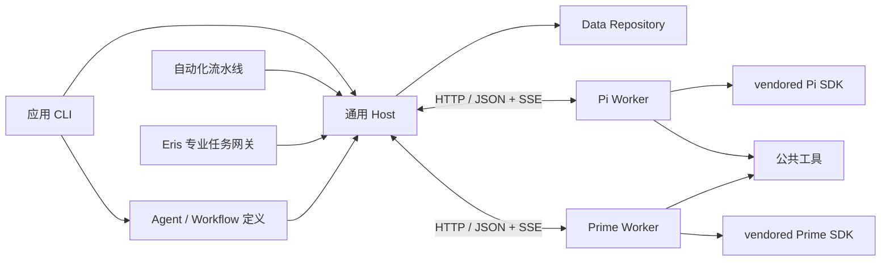

# 架构与扩展

[返回首页](../README.md) · [模块与源码入口](modules/README.md) · [开发与验证](development.md)

## 模块

应用 Host 组装具体 Agent、Workflow、存储与底座；通用 Host 只按注入的定义调度。模块职责、公开导出和依赖统一见[模块地图](modules/README.md)，评测流程和结果语义见[数据契约](contract.md)。



跨包只使用 `@eval/*` 公开导出。Agent 互不导入，Workflow 将前置结果映射为下一阶段材料；Host 不识别候选或判决。Data 管文件、锁与日志，Runtime 管进程、HTTP/SSE、会话与 SDK，Contracts 只放纯类型和规则。根目录 `schemas/` 是构建时复制的 JSON 资源；模型可见文案集中在[提示词模块](../packages/prompts/README.md)。

## 生命周期

一个 Host 管理一个 run，运行锁保证单一写入者；多个 run 使用独立目录。每个 Worker 同时执行一个 attempt，隔离会话、工具上下文和临时工作区。调度按任务依赖推进，各阶段可并行；空闲槽位优先分给运行任务较少的就绪阶段，同额时优先计划中靠后的阶段，运行中的任务不抢占。

任务、输入、attempt 和提交使用持久化 UUID。只有当前有效 attempt 能提交；同次提交重发沿用 UUID，相同 UUID 的冲突内容拒绝。提交、取消和替换串行化，正式结果与收据按[持久化顺序](usage.md#运行产物)保存后才确认。Host 仅为活跃 attempt 保留执行材料；结束后按收据处理重发。

Worker 清理会话和工作区后才报告终态，Host 收齐记录及工具产物后释放副本。失联先查收据，无收据才按剩余预算重试。托管 Worker 失效后由 Host 替换，外部 Worker 由调用方恢复。默认临时工作区在结束时清除；显式 `--debug` 才归档排查材料，清单见[运行产物](usage.md#运行产物)。

运行锁先完整写入 owner，再排他发布；owner 必须有有效 PID 与 token。只有确认进程不存在才回收陈旧锁，损坏 owner 或遗留回收标记直接报错。共用日志锁另有有界等待和初始化缓冲。锁的具体实现见 [files.ts](../packages/data/src/files.ts)，只支持可信单机协调。

重试中的上游继续阻塞其下游，只有本轮真正失败才保存依赖失败。失败熔断只消费通用阶段和 `ValidationIssue` 签名，不识别业务；暂停、预算、固定修复范围与同 run 续跑规则统一见[运行与恢复](usage.md#运行与恢复)。

## HTTP 协议

内部路由统一使用 `/api`，不设协议版本号。Host 与 Worker 同步构建，启动时校验底座身份、构建 UUID 和工具能力。请求传任务、输入及产物 ID；模型凭据只传环境变量名。服务只支持可信单机调用，不提供远程鉴权。畸形 URL、无效 JSON 和处理异常由统一 HTTP 边界返回错误，不退出服务进程。

路由实现分别在 [Host](../packages/host/src/runner.ts) 和 [Worker](../packages/runtime/src/server.ts)：

| 接口 | 行为 |
|---|---|
| Worker `GET /api/health` | 引擎、构建 UUID、工具能力与活跃 attempt |
| Worker `POST /api/attempts` | 校验能力并创建会话 |
| Worker `GET /api/attempts/:id` | 查询状态 |
| Worker `POST /api/attempts/:id/cancel` | 中断所属会话与进程 |
| Worker `GET /api/attempts/:id/events?after=N` | SSE 续读，也支持 Last-Event-ID |
| Worker `GET /api/attempts/:id/artifacts/:id` | 读取产物字节 |
| Worker `GET /api/attempts/:id/record` | 已结束尝试的用量、工具审计及未接受提交 |
| Worker `DELETE /api/attempts/:id` | 释放已结束 attempt 的副本 |
| Host `GET /api/inputs/:id?attempt=<attempt-id>` | 读取所属活跃 attempt 的材料视图 |
| Host `POST /api/evidence-bank` | 校验并持久化本任务证据选号目录 |
| Host `POST /api/inspections` | 校验并保存独立首查检查点 |
| Host `POST /api/submissions` | 校验并持久化提交 |
| Host `GET /api/submissions/:id` | 查询已保存收据 |
| Host `POST /api/tasks/:id/checkpoint` | 保存草稿、结构化错误和修复计数 |
| Host `POST /api/control/concurrency` | 使用运行锁 token 调整目标并发 |
| Host `POST /api/control/stop` | 使用运行锁 token 请求停止 |
| Host `GET /api/progress` | 进度、失败分类、吞吐与 ETA |

事件在每个 attempt 内按 `seq` 连续编号，携带 `attemptId/time/type/data`；Host 检测缺口、去重并续读。流式更新只记录增量，完整消息保存在 `message_end`。模型结束不代表提交成功。

状态查询超时或临时连接重置只表示本次观察未完成，Host 继续查询同一个 attempt；真实失联才进入收据检查。外部 Worker 繁忙或健康检查失败时，任务保持待执行，不消耗评测尝试；恢复空闲且身份匹配后重新调度。所有容量长期不可用时保存进度并中断，避免将整批题目判为失败。

Adapter 向模型注册工具时展开本地静态 JSON Pointer 引用，拒绝外部、循环或动态引用。提交工具的 SDK 层只检查完整 JSON 对象，原始 Schema 与业务校验由 Host 执行；普通工具继续使用 SDK 参数校验。Responses 流核对调用 ID 与终态参数，缺终态或 HTTP/API 5xx 按传输故障处理。内容、文件加载和传输分别使用有界预算，详细入口及反馈见[提交方式与反馈](contract.md#提交方式与反馈)。

GPT-5.6 / GPT-6 系列的 Responses 评测请求在固定系统提示词末尾设置显式缓存边界，SDK 追加的工作目录和日期保留在边界之后；文本、角色、工具和生成参数不变。纯提交任务首轮只缓存该共用前缀，材料读取和修稿轮保留隐式历史缓存；不预热、不复用判词或跨任务会话。两种 SDK 共用 Runtime 的请求转换。命中取决于服务端实际支持和可用缓存，以返回的缓存读取、写入和普通输入用量验证，不能只看总 token。机制依据 [OpenAI Prompt caching](https://developers.openai.com/api/docs/guides/prompt-caching)。

本机看板使用应用层 `/api/dashboard`：配置解析与预检复用 CLI，运行由独立 CLI 子进程执行，控制请求转发到持锁 Host。日期盘点和新运行预检可复用轻量输入索引，执行与续跑仍重读来源；结果详情按任务读取正式 JSONL。界面不承担调度或写结果，操作见[本机看板](usage.md#本机运行看板)，呈现规则见 [PRODUCT.md](../PRODUCT.md)。

## 接口和底座路由

核心接口见 [Contracts](../packages/contracts/src/index.ts)，应用注入入口见 [composition.ts](../apps/host/src/composition.ts)：

| 接口 | 职责 |
|---|---|
| `AgentDefinition` / `AgentProfile` | 能力、提示词、工具、请求/提交/结果 Schema、解析与业务校验；可按可信请求生成模型侧 Schema 及安全检查部分草稿 |
| `WorkflowDefinition` | 规划、恢复、材料绑定及依赖；`advance` 规划后续任务，`blockedReason` 检查额外等待条件 |
| `RunRepository` / `RunCodec` | Data 执行文件 IO，Workflow 提供纯状态编解码与结果转换；`RunLayout` 统一定义产物位置 |
| `InputSource` / `SourceReader` | 描述来源并解析源记录；Workflow 处理解析后的业务输入 |
| `AgentBackend` | 创建、运行、事件、取消和释放 SDK 会话；Runtime 客户端入口不加载 SDK |

`Workflow.bind` 接收当前任务清单，用于恢复共享标准与去身份映射。可信请求供 Schema、引用及业务校验使用，`AgentBinding.modelInput` 仅用于模型展示。证据目录由 Tools 登记实际返回页，Worker 在返回前保存，Host 核对追加前缀和真实来源。正式结果与首查恢复使用完整坐标；映射与证据细节见[数据契约](contract.md#证据与导出)。

Workflow 拥有盲测、归因补查、可选核验、改写槽位及聚类分片。归因接受后，Workflow 将点评按概述、判据、各 finding 和表格分组，每组最多20槽；新组进入同一回答的执行范围。Rewrite 模型返回同序 `rewrites: [{id,text}]`，动态 Schema 固定每个位置的槽位 ID，Workflow 按槽回填源结果；跨槽内容不能合并。原始输入留在源文件，状态保存恢复索引和未接受草稿，正式正文保存在 JSONL；完整和按任务读取复用流式路径，检查重复、冲突与缺行。

CLI 为运行选择统一底座；Host 库可用 `engineForTask` 路由到混合 Worker 池：

```ts
await runEvaluation({
  ...options,
  engine: 'pi',
  engineForTask: task => task.stage === 'attribution' ? 'pi' : 'prime',
  workerUrls: ['http://127.0.0.1:4101', 'http://127.0.0.1:4102'],
});
```

`AttemptSpec` 携带任务标识、底座与构建身份、模型、输入引用、预算、期限和评测契约；Host 不依赖 SDK 类型。同 run 保留已接受结果和任务 UUID，未完成任务使用当前路由与预算。

## 新工具

```ts
const extraTool: ExecutableTool = {
  name: 'count_inputs',
  inputSchema: {type: 'object', properties: {}, additionalProperties: false},
  async execute(context, _arguments, signal) {
    signal.throwIfAborted();
    return {content: [{type: 'text', text: String(context.inputs.size)}]};
  },
};
await startWorker(backend, workerDirectory, createRegistry([extraTool]));
```

将工具名加入 Profile 的 `toolNames`，并在 `toolDescriptions` 提供非空描述。内置工具描述只维护在 `packages/prompts/resources/tools/`；执行逻辑在 Tools 注册，两种 Adapter 转换为 SDK 工具，无须修改调度器。

工具预算区分探索、必读页、保留写稿和内容提交。`audit.calls` 记录全部调用；参数错误、重复读取和缓存命中仍计探索调用。Profile 用 `requiredReads` 声明材料，Host 与 Worker 共用 Contracts 的区间和分页计算；实际推进的新必读页不挤占探索额度。文件模式每个内容轮次保留一次写稿调用，总次数受累计内容上限约束；文件加载修正也不返还已用次数。具体计数由 [RequiredReadBudget](../packages/tools/src/required-reading.ts) 和[工具注册器](../packages/tools/src/index.ts)执行。

读取工具只在单个 attempt 内复用相同参数的结果，代码执行不缓存。代码返回摘要，完整 stdout/stderr、脚本和声明输出保存为可分页产物；错误分别保留脚本与产物读取原因。代码进程不注入模型凭据，取消、超时或 IPC 断开时回收所属进程组。工作目录不是安全沙箱，主动脱离进程组的代码不在清理保证内。

## 底座源码开发

Pi 与 Prime 使用独立 vendor 依赖树和锁文件，根 workspace 不包含 vendor。Pi 只注册应用从网关配置得到的模型，不加载内置模型目录；会话仅启用应用工具。Prime 保留 SDK 所需内置数据，但应用构建不下载目录资产，Worker 和直接 SDK 集成测试用 `PI_OFFLINE=1` 禁止自动刷新。

构建记录位于 `.runtime/pi.json`、`.runtime/prime.json`，记录底座版本、上游提交与随机构建 UUID；启动和 doctor 校验入口及能力。修改 vendor 后更新 [upstream.json](../vendor/upstream.json) 并重建，不在运行时自动升级。安装、源码检查和构建发布细节见[开发指南](development.md#构建与依赖)。

## 独立分析助手

[Eris](../agent/README.md) 通过 Contracts 中的数据源、专业任务网关和 Session 接口访问能力，应用 Host 注入实现。专业网关构造带 `id/bind` 的 `taskSource` 小计划，复用 Host 的 Worker、校验、正式提交和同 run 恢复。

Runtime 将 Pi 事件转换为 Deepseek Session 事件和 Assistant 流；前端沿用上游 HTTP RPC、WebSocket、会话投影与组件。Data 管理权威追加记录和单个持锁执行者，其他本机副本转发，确认进程退出后才接管。原始材料按业务引用重读，Pi 内存历史从追加记录恢复。模型、设置、数据与恢复细节统一见 [Agent 说明](../agent/README.md)。
