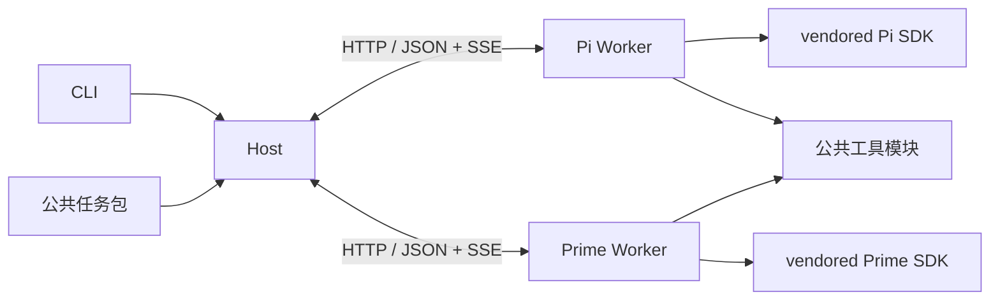

# 架构与扩展

[返回首页](../README.md) · 安装和操作见[使用指南](usage.md)。

## 模块



| 位置 | 职责 |
|---|---|
| `apps/host` | CLI、依赖、调度、收据、缓存、恢复 |
| `packages/contracts` | 跨进程任务、工具、事件与收据类型 |
| `packages/worker` | HTTP/SSE、预算、会话生命周期与提交 |
| `packages/agent-pi`、`packages/agent-prime` | 各自 SDK Adapter |
| `packages/pairwise-eval` | 唯一评测规则、输入适配、schema、证据校验、报告 |
| `packages/tools` | 材料、检索、图片、计算、代码执行和产物 |
| `vendor/pi`、`vendor/prime-agent` | 可直接开发的固定源码和锁文件 |

## 生命周期

Host 是单一写入者。每个任务可有多个 attempt，只有当前有效 attempt 能提交。提交 ID 来自 attempt 和结果的内容哈希；重复请求返回原收据。先原子写收据，再更新 manifest；两者之间崩溃时重启优先读取收据。提交、取消和替换 attempt 在 Host 内串行化，过期结果不能覆盖结果。

`.run-lock` 排除第二个 Host。进程不存在时回收陈旧锁；初始化不完整或遗留 `.run-lock.reclaim` 时拒绝继续，确认原进程停止后再清理。锁不提供跨机高可用。

每个 Worker 同时运行一个 attempt，独立会话、配置目录、材料副本、代码目录和日志；会话与临时工作目录清理完成后才对外报告最终状态。成功任务的事件、用量与产物归档到 Host 后，Host 通知 Worker 释放该 attempt 的磁盘与内存副本。失联先查收据，无收据才可重试。Host 管理的失效 Worker 会被替换，外部失效 Worker 需调用方重启后恢复。

## HTTP V1

请求用任务、输入和产物 ID，不传 Host 本机路径。输入按内容 ID 去重，下载时不重复校验哈希；产物按哈希读取。模型配置仅含 `apiKeyEnv`，实际密钥从环境注入。首版只支持可信单机调用，未配置远程认证，不应直接暴露公网。

| 接口 | 行为 |
|---|---|
| Worker `GET /v1/health` | 协议、引擎指纹、工具、活动 attempt |
| Worker `POST /v1/attempts` | 校验能力并创建会话 |
| Worker `GET /v1/attempts/:id` | 查询状态 |
| Worker `POST /v1/attempts/:id/cancel` | 中断所属会话与进程 |
| Worker `GET /v1/attempts/:id/events?after=N` | SSE 续读，也支持 Last-Event-ID |
| Worker `GET /v1/attempts/:id/artifacts/:id` | 产物字节 |
| Worker `GET /v1/attempts/:id/metrics` | 最终用量和工具审计 |
| Worker `DELETE /v1/attempts/:id` | Host 归档后释放已结束 attempt 的副本 |
| Host `GET /v1/inputs/:id` | 原始快照 |
| Host `POST /v1/submissions` | 校验、原子提交 |
| Host `GET /v1/submissions/:id` | 确认已保存收据 |

事件包含 `seq/attemptId/time/type/data`，在单个 attempt 内连续编号。Host 检测缺口、去重并续读；模型结束事件不代表提交成功。流式更新仅记录增量，完整消息保存在 `message_end`；开始、回合结束和会话结束事件不重复保存消息正文。

## 任务包和底座路由

实现 `EvaluationPack`：`plan` 生成任务与依赖；`prepare` 返回契约和 prompt；`validate` 执行业务校验；`report` 从收据生成展示；可用 `snapshots` 保存契约快照。传给 `runEvaluation`，不修改 Adapter。

`AttemptSpec` 包含任务标识、引擎指纹、模型、输入引用、预算、截止时间和评测契约。Host 不依赖上游 SDK 类型；底座公共接口只覆盖创建、运行、事件、取消和释放。

```ts
await runEvaluation({
  ...options,
  engine: 'pi',
  engineForTask: task => task.stage === 'correctness' ? 'pi' : 'prime',
  workerUrls: ['http://127.0.0.1:4101', 'http://127.0.0.1:4102'],
});
```

路由进入运行指纹，不能在同一 run 恢复时更换。CLI 选择统一底座，Host 库支持混合池；实际并发始终受总配置限制。

## 新工具

```ts
const extraTool: ToolDefinition = {
  name: 'count_inputs',
  description: '统计当前任务的输入份数',
  inputSchema: {type:'object', properties:{}, additionalProperties:false},
  async execute(context, _arguments, signal) {
    signal.throwIfAborted();
    return {content:[{type:'text',text:String(context.inputs.size)}]};
  },
};
await startWorker(backend, workerDirectory, createRegistry([extraTool]));
```

将工具名加入任务包的 `toolNames`。两种 Adapter 自动转换为原生 SDK 工具，无须修改调度代码。首版按代码注册，未提前建设 MCP、HTTP 工具连接器或插件市场。

探索调用统一计数，参数错误也占预算；提交有独立修正预算。材料工具提供分页、定位和可直接提交的 evidence。代码返回摘要，完整 stdout/stderr、脚本和 `outputs` 声明的文件存为可分页读取的产物；代码执行不缓存。

代码进程不注入模型凭证。生命周期监护进程在 IPC 断开、取消或超时后回收所属进程组。工作目录不是安全沙箱，主动脱离进程组的代码不属于此清理保证。

## 底座源码开发

直接修改对应 vendor，在 `upstream.json` 的 `local_changes` 记录说明后重建。两套上游 npm 包同名，必须保持独立依赖树。根 workspace 不包含 vendor。

Pi Git 归档缺少发布生成的模型目录数据，因此单独保存同版本 `vendor/pi-model-data` 及发布包 integrity；构建先恢复数据，再执行上游 `build:offline`，运行禁用自动网络刷新。

构建指纹位于 `.runtime/pi.json`、`.runtime/prime.json`，启动时核验源码和构建。修改源码必须重建。更新上游属于显式升级，需要更新提交、锁文件、来源清单并重新验证，不在运行时自动升级。
