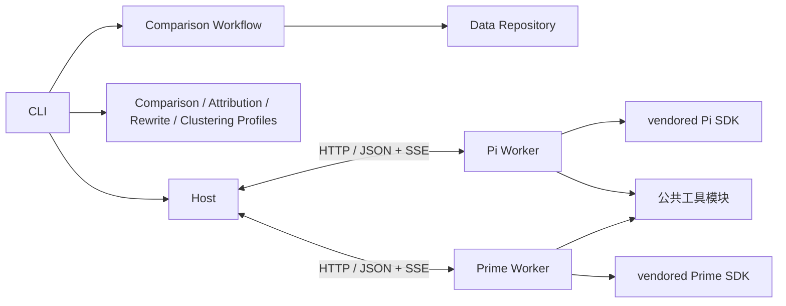

# 架构与扩展

[返回首页](../README.md) · 安装和操作见[使用指南](usage.md)。

先看模块表和[模块地图](modules/README.md)定位代码；只有扩展协议、工具或 vendor 时再阅读后面的对应章节。通用开发约束见[开发指南](development.md)。

## 模块



| 位置 | 职责 |
|---|---|
| `apps/host`、`apps/worker` | CLI、本机看板、配置、具体 Agent / Workflow / 底座组装 |
| `packages/contracts` | 通用 JSON、Agent / Workflow / Repository 接口、跨进程协议 |
| `packages/host` | 编排、调度、提交有效性、重试、恢复、进度 |
| `packages/runtime` | 进程客户端、HTTP/SSE、会话和工作区、Pi / Prime Adapter |
| `packages/agents/src/comparison` | 对比 Profile、提示词、业务校验；使用根目录 `schemas/comparison` |
| `packages/agents/src/rewrite` | 改写 Profile、提示词、槽位校验；只润色文本，不接触证据；使用根目录 `schemas/rewrite` |
| `packages/agents/src/attribution` | 归因 Profile、提示词、业务校验；只描述问题，不维护问题库；使用根目录 `schemas/attribution` |
| `packages/agents/src/clustering` | 聚类 Profile、纯问题库归类/合并与数量上限校验；文件读写和锁属于 Data；使用根目录 `schemas/clustering` |
| `packages/workflows/src/comparison` | 适配器注册表、配置化分组对比、盲测、依赖与材料映射、改写组合、状态编解码、报告 |
| `packages/data` | 本地源读取、原子状态保存、结果追加、锁 |
| `packages/tools` | 材料、检索、图片、计算、代码执行和产物 |
| `schemas` | 集中维护 Attribution、Comparison、Rewrite、Clustering 与 Workflow 的 JSON Schema |
| `vendor/pi`、`vendor/prime-agent` | 可直接开发的固定源码和锁文件 |

公开入口、依赖和验证入口见[模块地图](modules/README.md)。跨包代码依赖只使用 `@eval/*` 公开导出；根目录 `schemas/` 是集中管理的 JSON 资源模块，由构建步骤复制到运行目录。Host 不识别候选或判决，Data 不包含评测规则，Runtime 不负责跨任务调度，Contracts 不包含文件、网络或 SDK 实现。Agent 之间禁止互相导入；Workflow 将前置结果映射为下一 Agent 的输入。

## 生命周期

Host 是单一写入者。每个任务可有多个 attempt，只有当前有效 attempt 能提交。提交 ID 为 UUID，同次提交重发沿用原 ID；相同 ID 内容冲突时拒绝。提交、取消和替换 attempt 串行化，过期 attempt 不能覆盖当前任务。收据和对比结果按[持久化顺序](usage.md#运行产物)落盘后才确认；提交确认只依赖结构、引用和持久化顺序。

`.run-lock` 排除第二个 Host。进程不存在时回收陈旧锁；锁文件初始化不完整，或回收时遇到遗留 `.run-lock.reclaim`，则拒绝继续，确认原进程停止后再清理。锁不提供跨机高可用。

每个 Worker 同时运行一个 attempt，独立会话、配置目录、材料副本、代码目录和日志；会话与临时工作目录清理完成后才对外报告最终状态。默认 Host 只保留 `state.json` 中的收据、状态和用量，已接受收据同时固化产出它的 `evaluatorVersion` 和解析后的判官模型 ID，不保存模型连接配置；托管 Worker 使用系统临时目录并在结束时清除。开启 debug 后，参数、状态、用量、失败原因及未接受提交合并到 `_internal/` 的 `attempt.json`，事件单独压缩；记录与工具产物收齐后才释放 Worker 副本。失联先查收据，无收据才可重试。Host 管理的失效 Worker 会被替换，外部失效 Worker 需调用方重启后恢复。

## HTTP 协议

内部路由使用 `/api` 命名空间，不设置协议版本号。Host 和 Worker 同步构建部署，启动时校验底座身份、构建 UUID 和工具能力。

请求用任务、输入和产物 ID，不传 Host 本机路径。输入与任务按业务标识首次登记持久化 UUID，产物使用 UUID。模型配置传递 `apiKeyEnv` 而非密钥值，实际密钥从环境注入。当前只支持可信单机调用，未配置远程认证，不应直接暴露公网。

| 接口 | 行为 |
|---|---|
| Worker `GET /api/health` | 引擎身份与构建 UUID、工具、活动 attempt |
| Worker `POST /api/attempts` | 校验能力并创建会话 |
| Worker `GET /api/attempts/:id` | 查询状态 |
| Worker `POST /api/attempts/:id/cancel` | 中断所属会话与进程 |
| Worker `GET /api/attempts/:id/events?after=N` | SSE 续读，也支持 Last-Event-ID |
| Worker `GET /api/attempts/:id/artifacts/:id` | 产物字节 |
| Worker `GET /api/attempts/:id/record` | 已结束尝试的完整记录，包括最终用量、工具审计及未接受提交 |
| Worker `DELETE /api/attempts/:id` | Host 归档后释放已结束 attempt 的副本 |
| Host `GET /api/inputs/:id` | 本次读取的原始输入 |
| Host `POST /api/submissions` | 校验、原子提交 |
| Host `GET /api/submissions/:id` | 确认已保存收据 |
| Host `POST /api/tasks/:id/checkpoint` | 持久化最后草稿、结构化错误和修复计数 |
| Host `POST /api/control/concurrency` | 使用本机运行锁 token 调整目标并发并唤醒调度器 |
| Host `POST /api/control/stop` | 使用本机运行锁 token 请求停止当前运行 |
| Host `GET /api/progress` | 当前进度、失败分类、吞吐和 ETA 区间 |

事件包含 `seq/attemptId/time/type/data`，在单个 attempt 内连续编号。Host 检测缺口、去重并续读；模型结束事件不代表提交成功。流式更新仅记录增量，完整消息保存在 `message_end`；开始、回合结束和会话结束事件不重复保存消息正文。

应用 Host 的本机看板使用独立的 `/api/dashboard` 路由：应用层校验本次运行的可编辑字段（含评测模型范围）并复用 CLI 配置解析与 Workflow 预检；看板的预检/启动只生成概要计划（不装载原始输入），真正的 run 计划由 CLI 子进程构建；Workflow 的只读投影扫描已登记来源，生成可勾选的日期与可抽样样本，按业务标识列结果样本、重定位原始记录并只取问题与最终回答（不加载消息链路）；case 详情只含任务概要，任务结果在展开时通过 Repository 按任务读取正式 JSONL 行（不加载整个 run 的结果文件）。看板不承担任务调度或结果写入，控制命令仍转发到拥有运行锁的 Host；使用方式见[本机运行看板](usage.md#本机运行看板)。

## 接口和底座路由

[通用契约](../packages/contracts/src/index.ts)区分以下接口：

- `AgentDefinition` 登记能力；`AgentProfile` 配套定义提示词、请求 Schema、模型提交 Schema、接受结果 Schema、引用展开及业务校验。Worker 收到的 `EvaluationSpec.outputSchema` 是提交 Schema 的运行时副本。
- `WorkflowDefinition` 规划任务和依赖，恢复输入，将原始记录与前置收据映射为 `AgentBinding`。
- `RunRepository` 读写状态，为每个 run 创建结果写入器。Data 接收 Workflow 的纯 `RunCodec` 与结果转换函数，负责当前状态结构和 JSONL 转换；`OutputTarget` 指定目标，`RunLayout` 是 run 目录结构的唯一 owner。
- `InputSource` / `SourceReader` 描述一个版本的来源（单文件或递归目录）并在 Data 中解析，Workflow 只处理解析后的记录。
- `AgentBackend` 适配 SDK 会话。Runtime 的客户端公开入口不加载 SDK，Worker 应用按选择加载 Adapter。

[应用组装](../apps/host/src/composition.ts)将以上定义注入 `runEvaluation`。替换 Profile 时一起更新提示词、请求/提交/接受结果 Schema 和校验；Host 在依赖收据就绪后绑定任务输入、校验请求 Schema 并选择具备所需工具的 Worker，提交时再检查提交和解析后的结果。Schema 文件集中在根目录的 [`schemas/`](../schemas/README.md) 模块；当前通过 TypeScript 对象组合任务，不引入新编排语言。

源记录、任务、attempt、收据和正式结果分别管理：原始数据只在源文件，任务登记输入引用，attempt 使用临时材料，未接受草稿进入状态，正式结果写入 JSONL，状态仅保留恢复索引。证据按 `batch_id + case_id + version` 的业务标识定位，不依赖文件位置。问题库是每个模型一份的跨 run 知识库：按组件/问题类归类、出现样本可追溯；合并会更新类状态与样本归属，同时追加血缘事件，按模型锁住读改写（参见[使用指南](usage.md#目录约定)）。

归因已实现于 `packages/agents/src/attribution`：只输出每条回答的归因结果与 `problem.component/label/definition`，不读问题库、不建类。聚类已实现于 `packages/agents/src/clustering`：每个 `(模型 × 批次)` 可按 case 分片成多个任务，先把问题观察归入已有类，确实没有才在预算内新建，必要时合并近义类；问题库由 `data/problems/<version>.json` 持久化，报告与 `stats.json` 展示类数增长。新的金融领域能力遵循相同接口，组合属于 Workflow。Schema 驱动的后续改进沿这些模块边界扩展，本阶段没有 Coding Agent 或 RSI 系统。

改写已实现于 `packages/agents/src/rewrite`：它只接收 Workflow 选定的文本槽位，输出同 id 的润色文本；正式结果 JSONL 保留裁判原文，改写写入 `results/commentary.jsonl`，报告与逐题总结优先展示改写文案。

一个 Host 管理一个 run，多个 Worker 并行执行；多个 Host 使用不同 run 目录。每个 attempt 独立会话、工具上下文与工作区，取消只作用于所属任务；默认端口由系统分配。应用传入 Worker 入口、仓库路径和 Python 配置，没有全局共享会话。

`AttemptSpec` 包含任务标识、引擎版本与构建 UUID、模型、输入引用、预算、截止时间和评测契约。Host 不依赖上游 SDK 类型；底座公共接口只覆盖创建、运行、事件、取消和释放。

```ts
await runEvaluation({
  ...options,
  engine: 'pi',
  engineForTask: task => task.stage === 'attribution' ? 'pi' : 'prime',
  workerUrls: ['http://127.0.0.1:4101', 'http://127.0.0.1:4102'],
});
```

同 run ID 沿用持久化任务 ID 及 A/B 分配，始终保留已接受收据，未完成任务按当前路由和参数继续；输入与选择范围的处理见[运行与恢复](usage.md#运行与恢复)。CLI 选择统一底座，Host 库支持混合池；实际并发受当前目标并发限制。

## 新工具

```ts
const extraTool: ToolDefinition = {
  name: 'count_inputs',
  description: '统计当前任务的输入份数',
  inputSchema: {type:'object', properties:{}, additionalProperties:false},
  async execute(context, _arguments, signal) {
    signal.throwIfAborted();
    return {content:[{type:'text',text:String(context.inputs.size)}]};
  },
};
await startWorker(backend, workerDirectory, createRegistry([extraTool]));
```

将工具名加入 Profile 的 `toolNames`。两种 Adapter 自动转换为原生 SDK 工具，无须修改调度代码。当前通过 `createRegistry` 按代码注册工具。

探索调用统一计数，参数错误也占预算；提交有独立修正预算。材料工具提供分页、定位和用于提交的 `evidence_id`。`read_trace`、`search_trace`、`read_artifact` 在单个 attempt 内复用相同参数的读取结果，重复调用仍计入预算。代码返回摘要，完整 stdout/stderr、脚本和 `outputs` 声明的文件存为可分页读取的产物；代码执行不缓存。

代码进程不注入模型凭证。生命周期监护进程在 IPC 断开、取消或超时后回收所属进程组。工作目录不是安全沙箱，主动脱离进程组的代码不属于此清理保证。

## 底座源码开发

直接修改对应 vendor，在 `upstream.json` 的 `local_changes` 记录说明后重建。两套上游 npm 包同名，必须保持独立依赖树。根 workspace 不包含 vendor。

Pi 的本地 vendor 修改关闭内置模型与图片 Provider 登记。构建不生成或加载第三方模型数据；Worker 只注册应用从 `.env` 网关和运行配置解析出的模型，并关闭自动网络刷新。具体修改记录在 `vendor/upstream.json`。

构建记录位于 `.runtime/pi.json`、`.runtime/prime.json`，记录显式版本、上游提交和随机构建 UUID；启动及 doctor 检查版本、入口与运行能力。修改源码必须重建。更新上游属于显式升级，需要更新提交、锁文件、来源清单并重新验证，不在运行时自动升级；哈希与兼容约束见[开发指南](development.md#禁止项目哈希与兼容层)。
