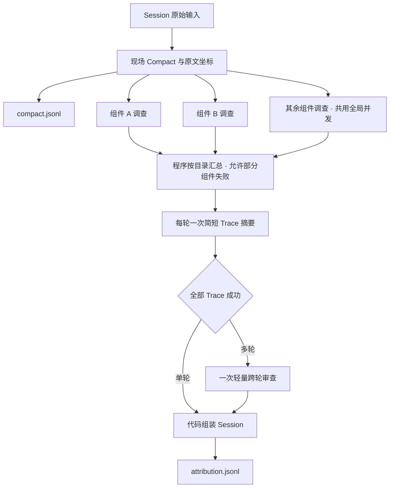

# Session 归因

Attribution 是独立 workflow，入口为 `workflow: "attribution"`。输入扫描以一行为一条评测记录，保留该记录的全部 trace，任何 trace 没有完整最终回答时整条记录过滤。按 trace 抓取的数据可有多行共享同一个 `session_id`；每条记录独立评测和落盘，不自动合并上下文。`meta.n_traces` 保留来源会话的总数，允许大于当前记录实际包含的 trace 数量，但必须是不小于实际数量的整数；规划和进度只统计当前 `traces[]`，不补造缺省上下文。完整会话输入仍以一行保留全部 trace。Score、Rewrite、指令遵循归因 和 Clustering 都不属于这条 workflow。

AIME 的 `4_daily_eval_slim` JSONL 可以直接作为输入。每个 trace 的 `message_pool` 和 `tool_sets` 在输入边界按索引恢复：保持消息顺序、对象字段顺序和原始证据路径，不改写正文，不另存展开后的输入文件。重复消息共享内存中的对象，内部规范投影也复用共享结构；缺失、越界或非整数引用报错，不把坏引用当成空材料。未使用共享池的 trace 保持原样。

采集 trace 子集时，外层 `meta.n_messages` 同样保留原会话总数，允许大于当前记录的消息总数；完整会话的外层计数和每个 trace 的消息计数继续精确校验。评测材料仅使用实际采集的消息，不按外层计数补造内容。

## 任务结构

```text
session input
→ attribution-compact-field（每个字段一个独立、单轮模型会话）
→ attribution-compact（代码拼装，无模型调用）
→ attribution-component（按本轮 Compact 目录并行调查，共用全局模型额度）
→ attribution-trace（程序合并组件问题，模型只写简短 summary）
→ attribution-session（单轮代码组装；多轮一次轻量跨轮归因）
→ results/compact.jsonl + results/attribution.jsonl
```

每条实际收到的输入记录生成一条 compact。输入包含几轮就处理几轮，不跨记录拼接、不按外层计数推测未采集的上下文。Compact 是 Attribution 的必需前置任务；正常重试后仍失败时仅暂缓该 session，其他 session 继续，续跑复用已完成工作。

Compact 顶层严格只有 `session_overview/session_meta/trace_meta/turns`。会话概览是三条文字组成的列表，依次说明用户问题、实际工具调用及报错、回复和交付；工具名称和调用次数由程序从实际调用记录统计，报错次数来自逐轮去重的工具错误。`session_meta` 原样透传外层元信息，`trace_meta` 按输入轮次原样透传各 trace 的元信息，不加入评测身份或摘要来源标签。

每轮严格保留以下字段；空分区填空数组，不允许自定义字段或子对象：

| 字段 | 条目固定字段 |
|---|---|
| `turn_idx` | 从0开始的实际轮次，由程序生成 |
| `plans/reasoning_chain/execution_chain` | `step_idx/content/evidence` |
| `reflections` | `reflection_idx/reflection_content/evidence` |
| `tool_errors` | `tool_error_idx/tool_error_content/evidence` |
| `final_answer` | 完整最终回复原文字符串，由程序复制 |
| `components` | `components_idx/components_name/components_kind/components_content/evidence` |
| `key_data` | `key_data_idx/key_data_content/evidence` |
| `artifacts` | `artifacts_idx/artifacts_content/evidence` |

条目 idx 由程序从1开始连续生成。模型只提交固定文字槽位和 `evidence` 整数选号数组；组件另外选择 `model/tool/script/skill` 类型，并通过 `actor_indices` 选择程序列出的实际来源。来源选号只用于组装，不进入正式结果。匿名模型调用只按可见职责合并为“规划 / 推理 / 答案合成”，不逐调用起业务名或强制一一列出；具名 Agent、工具、脚本、skill 和内层服务保留真实名称。正式 evidence 是固定的 `{evidence_id, quote}` 数组，由程序解析为不超过400字的原文，禁止模型生成来源对象或任意嵌套。每项至少一处依据，引用必须属于当前实际轮次；摘要不能冒充引文，写入后及归因前都核对可见片段与原始来源。源 UUID、展平消息序号、字段路径及半开 UTF-16 范围与后续归因、Criteria、Comparison 共用。隐私投影后的父对象不可作为原文，重复数值保留不同的原始坐标。

每轮八个字段各用独立单轮模型会话，另用一次会话概括用户问题和交付。程序插入工具统计、透传 meta 和最终回复、合并组件并组装正式结果，不调用汇总模型。字段并行共享全局模型并发，已就绪归因优先；默认 `bindings.attribution-compact.thinking: "off"`，不探索，一次提交，结构或引用失败最多定向修复一次，不做语义或语言返工。共享材料按实际轮次独立分配过程与数值预算，保留明确诊断、仅见于输入快照的工具回执和精确原生值，不把快照回执另算一次调用。

字段材料先按来源职责筛选，再按完整句段分配预算；短原文完整保留，长原文按段落、代码行或完整句子分割，不用消息总数摊薄预算后截取十几个字的首尾，预算不足时省略。调用次数只由程序统计和组装，`session_overview` 与 `tool_errors` 的摘要不写“共N次”“第N次调用”，其他字段可按原文可见动作概述次数，消息序号不当调用次数。

各分区按职责简要摘要，同一事实避免重复展开：规划保留计划身份，推理只接收可见推理文字、不从 JSON 查询计划倒推隐含判断，执行只接收真实工具调用与回执并合并重复尝试，反思必须有真实的纠正或路径调整。tool_errors 一次明确执行报错一项，不判断业务结果正确性，不把空数据、零行、校验 CHECK、展示截断或未核验当成报错；key_data 只接收终稿原文，不接收工具数据、数值菜单或交叉核验材料。模型只选短句或表格行的 evidence，程序逐字复制到 key_data_content，保留主体、期间、数字、单位及限定词，不换算、重算、纠错或补全；记录的是终稿声称的数据，真实性由归因核查；artifacts 每个可确认文件产物只列一次，区分声称生成与实际交付。正式 Schema 禁止所有未声明字段和类型。

程序从原始记录整理模型、Agent 和工具身份，components 字段描述完整链路并补充内层服务、脚本和 skill。匿名模型只按可见职责合并为“规划 / 推理 / 答案合成”，不强制列出每个调用；明确命名的 Agent、工具、脚本、skill 与内层服务保留真名，程序以来源选号和原文坐标保留实际节点身份；不把 llm-call 等定位符、模型型号或通用兜底文案当作组件描述。components_content 简要写清为什么需要、实际做了什么、结果怎样；目的依据用户要求或可见规划，结果依据实际输出，未见结果时如实说明。归因读取同一份名称、说明和证据，正式 component 直接沿用该目录名称，不重新生成或退回原始调用 ID。程序从实际解释器命令、calc.py 的 --code-file 参数、view_skill 及 SKILL.md/ROUTE.md 的实际读取补入具名来源；已执行 Python 脚本或内联命令中可核实的本地文件导入也列入，保留文件、导入与执行证据。仅写入而未执行的 heredoc 正文、内联代码本身和数据文件不另造脚本组件。具名来源必须覆盖，每项绑定至少一个本轮已有来源编号；历史上下文中出现的工具不冒充本轮执行，结构修复反馈一次列明全部重复分组与来源并集。长命令另补包含文件名的短原文；实际工具、脚本和 skill 名称必须有逐字原文支持。数据、配置和交付文件不当作执行组件，JSON 文件不能列为脚本。组件存在不证明有错，名称提及不证明已执行。Compact 是唯一组件目录；程序按调用链把请求生成、执行工具、脚本和 skill 划为一个调查组，答案合成、推理与规划组成交付组；答案合成即产出最终答复的那次模型调用，程序按出错能力把它展开为「答案合成·取值/计算/推断/无据内容/引用/指令遵循」，每条问题选最早出错的能力；模型逐次核查原始输入、动作、回执和交付影响，每条问题用 actor_index 选择组内组件，程序复制目录名称。匿名请求生成由程序命名为「<工具或内层脚本> 请求生成」；经 shell 运行的脚本以 shell 为执行入口、脚本为执行组件，从 skill 目录以相对路径运行的脚本与其绝对路径合并为同一组件。错误请求定位请求生成者，实现错误定位具体脚本或服务，skill 正文错误定位具体 skill，不因 shell 执行就归责 shell，也不因终稿有错就排除上游故障。脚本产生且未修复的不可用产物归到脚本，终稿如实披露失败不转移责任。组件独立审查，允许同一真实故障在多个组件中分别记录有证据的责任动作，不做跨组件语义去重。

字段完成后可独立续跑；完整 Compact 落盘后，程序为每轮的每个调查组创建独立任务。目录只定义检查对象，正常组返回空 problems。调查任务共享全局模型请求额度，可同时执行；按分组顺序合并结果。各组都收到终稿关键数据（final_claims），工具组据此确认本组错误回执是否进入终稿，已进入的按影响定 P0–P3。组件失败作为内部覆盖缺口保留，Trace 等待全部组件任务结束后继续汇总；Trace 摘要失败则阻塞 Session，不能跳过失败轮次生成会话归因。



组件材料按实际调用配对：`invocations` 为每次请求保留原始参数/代码、对应回执、请求生成者和执行组件，并按原始顺序提供修复链；不再用最后两次调用代表全部执行。逐次核对主体、期间、单位、字段和计算，不能用调用成功或终稿采用证明业务正确。`context_invocations` 配对提供必要替代路径及终稿引用的来源，`user_requirements` 保留当前及前序原始用户约束。实际加载的 skill 正文保留原文和补读入口，`callable_contracts` 提供相关模型调用中的真实工具契约；系统和 developer 私密规范继续隔离。去掉消息封装的角色、调用ID、重复输入位置和重复JSON父对象；表格JSON按完整原始行或属性保留，不重写或换算。每次调用单独分配原文预算，长代码、修复和数据可沿 `read_requests` 补读；未见或未核实的实现须说明不确定，不能判正常。

组件只提交 content、evidence、tool_error_reviews、problems，程序绑定名称；content 与每条 tool_error_reviews.content 要求不超过600字，校验上限放宽到1200字。每条分派到该组件的异常须恰好处置一次：unresolved_impact 表示未恢复且有剩余交付影响，recovered_impact 表示已恢复但仍有交付影响，两者关联本组件问题并按剩余影响定 P0–P3；recovered_no_impact 表示已恢复且无交付影响，必须选择报错后的实际工具回执；no_delivery_impact 表示未恢复但交付不受影响；后两者记 P4 过程缺陷；uncertain 表示根因或影响不清，不关联问题。除 uncertain 外，每条处置都由一条问题的 tool_error_indices 关联，每条问题都必须提交该键，无关联异常时为空数组。没有 tool_error 的 planning、request_generation 或 script 过程缺陷，也只有已证实终稿未受影响时才记 P4。P4 问题的 evidence 必须包含程序给出的终稿消息、tool_result、function_call_output 或 role=tool 的实际回执，severity_reason 写明终稿未采用、已替代或已修正；只引用报错回执、请求本身或普通 assistant 规划消息不够。P4 判断最终交付是否受影响，而不是每个枝节事实是否已核实：次要细节未核实不影响记 P4，只有最终交付影响本身未确认、未核实或可能时才不报 P4，不能用 P4 兜底。计划或终稿自述不能证明恢复；恢复反馈会列出报错后的候选工具回执供补选。核查与异常关联保留在内部收据；正式问题的 `component_family`/`component_role` 由程序派生，不经模型提交。失败组件未完成的异常处置保留为覆盖缺口，不冒充已经检查。

异常清单不是问题白名单。exit_code=0 或文件保存成功仍须核对实际内容、公式、单位和验收结果；脚本产生空表或错误公式应定位具体脚本，不伪造执行异常。最终答复只记录自己新增的误读、计算、结论或表达偏差。上游失败、终稿如实披露时，不能改称“交付缺失”并清空异常关联来转移责任。所有组件都须证明剩余交付影响；已被替代路径消除的检索偏差、无关回执或早期错误仅作内部记录，不能猜测额度浪费并报 P3。允许重复计责，未知因果不编造，不按比例分配组件。

Trace 使用代码合并的组件结论写一段 summary，问题和 meta 原样回填，不能增加、删除或改写问题。若部分组件失败，程序标注评测覆盖不完整；这不是被评 Agent 的问题。单轮 Session 直接使用 Trace 结果组装。多轮 Session 接收有序轮次的总结、问题概要和必要原始问答，最多一次轻量审查，生成 session_summary 与独立跨轮 session_problem；跨轮问题必须有至少两轮原文证据，程序从 Compact 联合目录回填名称，不重复单轮问题。

Compact 接受后立即写 `results/compact.jsonl`，Session 接受后立即写 `results/attribution.jsonl`；其他 session 无需等待。默认业务交付按模型和原始完整日期组织：归因为 `<模型>/<模型>_attribution-YYYY-MM-DD.jsonl`，摘要为 `<模型>/compact/<模型>_compact-YYYY-MM-DD.jsonl`。持久化与续跑均保留任务 UUID、一基行号、原始来源和已接受结果。完整成功的归因仍跨版本复用；旧归因缺摘要时只补 compact，不自动重评正式判词。

调度按输入记录准入，`execution.sessionWindow` 默认16；代码拼装与就绪归因优先于新字段任务；代码任务不占模型 Worker 或网关额度，持久化接受提交后立即唤醒下游调度。失败或阻塞的 session 释放窗口，完成度仍以 session 任务为准。

## 正式契约

```json
{
  "session_meta": {},
  "turns": [
    {
      "meta": {},
      "summary": "",
      "problem": [],
      "is_correct": 1,
      "correct_reason": ""
    }
  ],
  "session_summary": "",
  "session_problem": []
}
```

`session_meta` 与每个 `turns[i].meta` 直接保留输入值。`is_correct` 使用 `1` 表示与标准一致、`0` 表示不一致、`null` 表示没有标准或无法据给定标准判断。turn 和 session 的 Problem 同形：

```json
{
  "component": "finquery 取数服务",
  "component_family": "finquery",
  "component_role": "tool",
  "label": "零行结果未识别",
  "definition": "应返回数据的查询返回零行，后续仍据此形成事实结论。",
  "problem_phenomena": "第一问把零行取数结果当成有数据支持。",
  "reason": "工具请求查询 X，原始返回为零行，下一轮仍给出肯定结论。",
  "severity": "P1",
  "severity_reason": "重要结论缺少数据支持，需要重新取数核对后才能使用。",
  "evidence": [
    {
      "position": "trace_index 0 / message_index 3 / path /output/0/text / evidence_id ev_11111111-1111-4111-8111-111111111111_3_text_0_8_/output/0/text",
      "component": "tool_call: finquery 取数服务",
      "quote": "为您找到0条数据",
      "reason": "证明工具返回零行。"
    }
  ],
  "calculations": [
    { "text": "计算错误：将 5.89 亿元误写成 589 亿元，放大了 100 倍。" }
  ]
}
```

`component_family` 与 `component_role` 由程序派生，模型不提交、不改写。调查组只是调查范围，组 `key`/`links` 不写入问题身份，成员也不继承组 family。每个成员按自己的来源或实际调用目标确定：工具、脚本和 skill 使用自身名称的 basename（去掉 `.py/.sh/.js/.mjs/.ts` 扩展名）；程序命名的请求生成按它实际服务的 target（`shell 请求生成` → `shell`，`finquery.py 请求生成` → `finquery`）；具名规划模型按它自己发出的调用目标，只有一个目标族时使用该族（`planner-finquery` → `finquery`，`planner-search` → `web_search`），没有目标或目标族不唯一时记 `model/planning`。`contains_final_generation` 和「答案合成」记 `answer_synthesis/delivery`，同组其他规划成员仍记规划角色，不因位于交付调查范围就改记 delivery。工具组内的 `program_request_generation` 成员角色为 `request_generation`，其他请求生成者为 `planning`。名称缺失、目标不可解析或未知 kind 分别回退 `other` 和 `tool`（model 回退 `model/planning`），不抛错。会话级问题从 `processComponents` 联合目录派生：答案合成（匿名模型且名称为「答案合成」，或带 `contains_final_generation`）为 `answer_synthesis/delivery`；script/tool/skill 使用自身归一化名称和 kind；其他 model 为 `model/planning`。原始 `component` 名称保持不变，历史正式行不补造这些字段。

`quote` 上限为400字；工具和错误反馈只提供不超过400字的可提交片段。引文必须是精确连续原文，不能拼接或由程序截断。`position` 保留原始轮次、轮内消息和字段路径，末尾附 ` / evidence_id <完整坐标>`，外部字段结构不变；后续阶段直接解析该 ID，不生成临时替代来源。`evidence.component` 明确区分 `reasoning:`、`tool_call:`、`model:`（模型调用的可见输出）、`answer:` 等证据位置及具体组件。`calculations` 只保留文字点评，不再嵌套操作数和复算元数据。

正式 Problem 不含 problem_id 或替代 ID。内部定位使用原接受收据和原生 JSON 路径：逐轮为 `/turns/<轮次>/problem/<位置>`，跨轮为 `/session_problem/<位置>`；路径由数组位置生成，不写入 Problem 正文。Comparison、聚类、召回和复核使用 `problem_path` 并保留来源收据；同一收据跨 run 复用不新增问题身份。历史正式行保持原样，不生成编号、UUID、哈希或迁移副本。

新生成的每条 Problem 必填 `severity`（P0/P1/P2/P3/P4，P0 最严重）和 `severity_reason`，按本次对最终交付的已确认影响判定；已补救的问题按残余影响分级，无残余交付影响的执行异常不生成问题；不能仅凭解析报错推定请求不合规。P4 只表示已证实最终交付未受影响的过程缺陷（终稿未采用该结果、已用替代来源完成或错误已修正且无残余影响），证据须为程序给出的终稿消息、tool_result、function_call_output 或 role=tool 的实际回执；次要细节未核实不影响 P4，只有最终交付影响本身未确认、未核实或可能时不报 P4，不能把 P4 当兜底，也不代表 session 成功；同一 session 可以同时有 P4 和 P0–P3，报表同时展示。同类问题在不同回答中可以有不同等级，不按等级拆类，也不改变 Comparison 的判胜规则。分级口径与点评表达统一维护在[问题表达规则](../packages/prompts/resources/attribution/problem-output.md)。组件调查与 Session 各自填写本阶段产生的问题，正式导出原样保留。跨版本复用的历史正式行不补造后来新增的字段。

提交只校验 Schema、字段范围、证据身份、原文坐标及读取证明；不靠占位词黑名单、相似措辞或语义重复判断触发返工。来源预览的编号只对应已展示的连续原文，完整长段在展示时拆成不超过400字的独立片段，各自保留原始坐标。工具沿用相同限制；拒绝提交时一次反馈全部引用问题和可选短片段，要求替换对应 evidence.index，不逐条消耗修复次数。校验不会改写或截断所选 quote，不增加校验阶段或预算。

## Trace 与 Session 汇总

组件调查拥有过程核查职责。Trace 只提交 summary；有显式标准时另提交 is_correct/correct_reason，无标准时程序固定 is_correct=null 和未提供标准的说明。Trace 问题完全来自程序合并，不经过模型改写。

Session 仅在所有 Trace 摘要成功后运行。单轮无需模型请求；多轮接收有序 Trace 结论和必要原始问答，独立跨轮问题以 {index, reason} 选择原文，程序映射回原始 trace、消息和字段坐标。原有 turns 原样保留，评测覆盖缺口不转化为被评组件缺陷。

所有新生成的描述使用中文，特别是 `label`、`definition`、问题理由、总结和严重程度理由；真实工具名、代码、单位与原文引文保留原样。该要求通过提示词表达，不新增语言校验或润色循环。

## Comparison

Comparison 是另一个独立 workflow，按整场 session 比较，不逐 trace 判胜。单轮和多轮共用原始来源目录；首屏可合并展示有序问答，正式引文仍定位每轮原始消息，独立核验覆盖所有实际交付轮次。Attribution 结果提供整场总结、turn 问题和 session 问题，用于识别最终交付与跨问答逻辑。结果查看与问题样本复核也用相同展平消息索引解析原文。

## 验证

开发运行 `npm run typecheck` 和 `npm test`；提交前运行 `npm run test:full`；涉及 Worker/SDK 时运行 `npm run test:integration`。真实样本必须覆盖多 trace、空工具返回、零行、工具报错、截断和最终回答缺失过滤。
